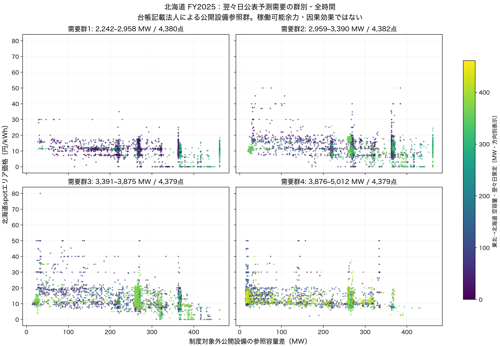
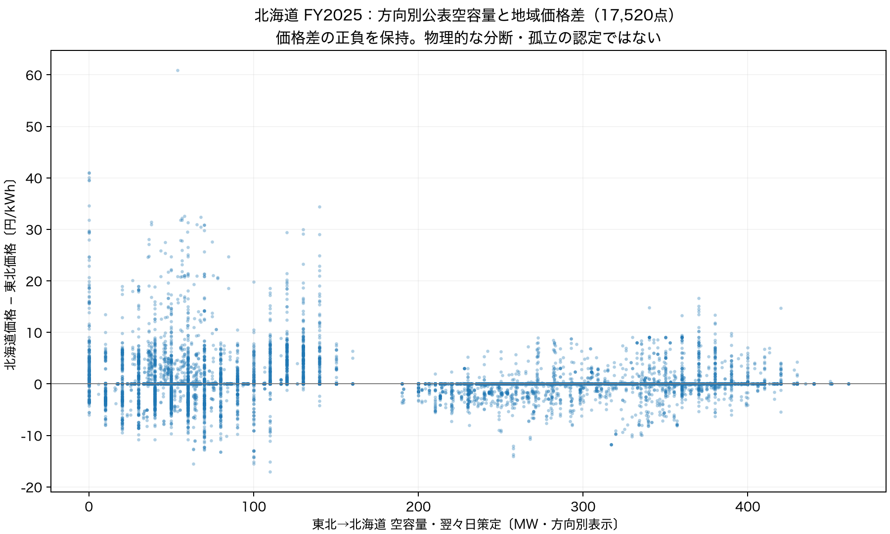

# 13　北海道：公開設備の参照容量差と価格を見る（Issue #27）

## 今回の図で分かること

**北海道の全17,520コマについて、指定された主散布図と、輸入方向の公表空容量・地域価格差の補助散布図を作りました。**
横軸の参照群は、点検済み台帳が参照する法人を個別確認した**3公開設備・参照容量462MW**です。
設備集合は通年で変わらず、描画できないコマは0でした。

ただし、参照容量差のコマ方向和の**78.91%は発電量0のセルに由来**します。
横軸は追加で発電・入札できる量ではなく、参照台帳値と実際の平均出力の差です。
図に表れる関連を、数量抑制やその利益、価格への因果効果へ読み替えません。

北海道を選んだのはユーザーの事前指定によります。価格結果を調べる前に、既存の単一の東北→北海道方向を使う計画を[Issue #27](https://github.com/gochiglog/jepx-market-power-analysis/issues/27)と[計画書](history/plan.md)へ記録しました。
図の見栄えを理由に他地域へ変更していません。

## 1．どの設備を足したか

分類は**HJKSの「発電事業者」欄に記載された法人**とFY2025スポット対象一覧の照合です。
所有者・運営権・売電権・契約供給力の帰属を認定したものではありません。
制度一覧は従来どおり**10法人・11法人×エリア**で、北海道の対象法人は北海道電力株式会社です。
対象期間2024-11-01〜2026-03-31はFY2025全体を含みます。年度末資料の公式検索抽出による事後確認で、原PDFは403のため未確認です。[公式資料p6](https://www.egc.meti.go.jp/activity/emsc_systemsurveillance/pdf/019_08_00.pdf)

北海道の観測25 unitラベルでは、対象22・対象外3・不明0でした。
対象外3法人はそれぞれ公式会社名を確認した明示registryへ登録し、制度一覧と照合しました。未確認の名前や設備対応保留を、単なる不一致として対象外へ入れるコードにはしていません。

| 対象外として参照した公開設備（元名は一覧に保持） | HJKS記載法人 | 参照容量MW | FY2025観測発電量kWh | 発電量0のコマ |
|---|---|---:|---:|---:|
| 苫小牧共同火力3G・単独 | 北海道パワーエンジニアリング株式会社 | 250 | 494,725,000 | 11,358 |
| 室蘭中央第5号発電設備・室蘭中央5号 | 日本製鉄株式会社 | 100 | 681,776,000 | 2,849 |
| 釧路火力発電所・1 | 株式会社釧路火力発電所 | 112 | 658,828,500 | 3,269 |

公式名称の根拠：[北海道パワーエンジニアリング](https://www.hpec.jp/corporation/)、[日本製鉄](https://www.nipponsteel.com/company/about/)、[釧路火力発電所](https://kushiro-tpp.com/company/)。確認日2026-10-16。
北海道パワーエンジニアリングの公式ページには北海道電力等の株主名も記載されていますが、今回の台帳記載法人の照合では親子会社を同一法人へ統合しません。
したがって、この3法人を「独立した競争的供給者」と認定した意味でもありません。現在台帳の記載とFY2025各時点の役割の証明も区別します。

[全25設備の分類・容量・発電量・台帳出典](qa/asset_reference_registry.csv)、[4法人の名称確認registry](../../metadata/research/hokkaido_business_reference_classification_20261016.csv)に追跡情報を保存しました。
北海道の点検済み公開観測ラベルに対する台帳参照率100%と、北海道の制度対象外供給者全体の網羅率は別です。後者の分母は確定していません。
今回の3設備の観測発電量は1,835,329,500kWh、北海道の公開観測25ラベルの合計は16,512,511,140kWhですが、これも地域全発電・供給権全体の比率ではありません。

## 2．横軸と計算できる範囲

名称は**「制度対象外公開設備の参照容量差〔MW〕」**です。

```text
R_ref_MW = Σ(capacity_reference_kw − generation_kwh_30min / 0.5) / 1000
```

元のkWh/30分を0.5時間で除して平均kWとし、容量差を1000で除してMWにします。
参照台帳容量を観測期間中一定とする、承認済みの固定診断の仮定を引き継ぎます。FY2025の容量履歴を確定したものではありません。
停止平均低下量の控除、負値切上げ、欠測の0化、実績最大値による容量置換はしていません。

| 確認項目 | 結果 |
|---|---:|
| 元北海道unit観測 | 438,000行＝25×17,520 |
| 参照群unitセル | 52,560＝3×17,520、すべて計算可能 |
| 対象設備数・既知参照容量 | 全コマ3、462MW |
| 参照群の元出力欠測／unit日不存在／容量保留／分類不明 | すべて0 |
| 観測集合・計算集合の種類数 | それぞれ1、通年固定 |
| R_ref_MWの最小／中央値／最大 | 13.4／267.2／462MW |
| R_ref_MWの異なる値 | 1,487、ほぼ一定ではない |
| 個別設備の負の差 | 室蘭中央5号1,919セル、最小−6MW。無修正で加算 |

集計値は全コマで正ですが、これは個別設備の負値を修正したためではありません。
設備数が3と少なく、出力の離散的な値や長いゼロ出力もあるため、散布図に縦の帯が出ます。これは幅広い供給者の連続的な供給反応を観測したものではありません。
一般の実装では全計算不能をnullとし、不完全な部分和にはflagと設備集合を付けます。全期待設備が揃うときだけ値を持つ`R_ref_complete_MW`も併記しました。

### 燃種・公表記録は別の内訳として持つ

原燃種は苫小牧共同3Gが「火力（石油）」、残る2設備は空欄です。外部知識で燃種を付け足していません。

| 原燃種 | unitセル | 参照容量差MW・コマ | ゼロ出力由来差MW・コマ |
|---|---:|---:|---:|
| 火力（石油） | 17,520 | 3,390,550 | 2,839,500 |
| 原セル空欄 | 35,040 | 1,033,031 | 651,028 |
| 合計 | 52,560 | 4,423,581 | 3,490,528 |

ここでの**MW・コマは時刻方向の和で、同時点の容量でもエネルギーMWhでもありません。**
ゼロ由来差は合計の78.91%、苫小牧共同3Gのゼロ由来差だけで64.19%です。ゼロ出力を停止・利用可能のどちらとも自動認定できません。

2snapshot×早端/遅端の4条件を保持した公表区分寄与も作りました。この3設備では4条件の**主区分別の集計は同じ**でした。
ただし58,852版の早端/遅端の予定該当flagは749 unitセルで異なります。主区分は復旧日等を境界保留とする設計で、実際の停止が確定した意味ではありません。

| snapshot収録記録の主区分（1条件分） | unitセル | 参照容量差MW・コマ | ゼロ由来差MW・コマ |
|---|---:|---:|---:|
| 日付境界保留 | 657 | 99,586.6 | 83,750 |
| 複数記録保留 | 1,504 | 163,642 | 163,080 |
| 計画停止の予定区間に該当する記録 | 9,116 | 1,597,618.4 | 1,577,250 |
| 出力低下の予定区間に該当する記録 | 2 | 114 | 該当ゼロセルなし（null） |
| 計画外停止の予定区間に該当する記録 | 2,077 | 519,250 | 519,250 |
| 該当する記録なし | 39,204 | 2,043,370 | 1,147,198 |

区分は各条件内で排他的ですが、**4条件間を加算しません**。「記録なし」にもゼロ由来差があり、停止なし・入札可能とは読めません。
全コマの内訳はParquet、期間要約は[燃種別](qa/contribution_fuel_summary.csv)と[公表区分別](qa/contribution_public_record_summary.csv)です。

## 3．主散布図：需要の見通しが違う時間を並べる



1点＝30分。縦軸は北海道spotエリア価格、横軸はR_ref_MW、色は**東北→北海道・系統空容量・翌々日策定の確認済み方向別表示**です。
凡例と軸範囲は4パネル共通で、全時間を基本にしました。低需要、両地域の価格が等しい時刻、極端な値も元表から除いていません。

需要は北海道の**翌々日断面の公表予測需要**です。実績需要ではありません。
25/50/75%点は2,958.75・3,390・3,875MW。境界以下を下側へ入れ、同値を分断しないため件数は完全な4等分ではありません。

| 群 | 実際に含まれる予測需要MW | 点数 |
|---|---:|---:|
| 1 | 2,242〜2,958 | 4,380 |
| 2 | 2,959〜3,390 | 4,382 |
| 3 | 3,391〜3,875 | 4,379 |
| 4 | 3,876〜5,012 | 4,379 |

群1・2では横軸の大きい側に低価格の点が見え、群4でも同じ参照容量差の近くで価格・色が異なります。
高い価格は単一の需要群だけに現れるわけではなく、今回の最大80円/kWhの点は群3です。
これは図の記述であって、需要や輸入条件を揃えた因果比較ではありません。同じ色も他の市場条件が同一であることを保証しません。

## 4．補助散布図：方向別の公表空容量と両地域価格差



横軸の原連系線名は「北海道・本州間電力連系設備」、原方向は逆方向です。
確認済みの系統CSV表示規則に限り、原空容量×−1の既存比較列を使用しました。原値と式・URL・出典行も新パネルの`import__`列群へ保持しています。
別設備を足さず、全ソースへの絶対値化もしていません。表示値は0〜461MWでした。

北海道価格−東北価格は、正2,630・ゼロ12,466・負2,424コマ、範囲−17.08〜60.85円/kWhです。
正の価格差は公表空容量0の194コマだけでなく、正の空容量がある2,436コマにも現れます。
この並置は翌々日の計画断面と受渡日の価格との関係です。容量の更新・配分・他制約や同時決定を無視して、物理的な制約の有無を認定できません。
既存spot・市場表には公式分断結果の独立列がないため、正負ゼロは**価格差の区分**としてだけ保持します。areaとsystem priceの相違から北海道単独分断を作っていません。

## 成果物の場所とQA

[ノートブック04](../../notebooks/04_hokkaido_scatter.ipynb)は先頭から画像を表示し、続くセルで設備・パネル・寄与を確認できます。
PNGはこの報告内、共有・保存用PDFは[主図](figures/hokkaido_reference_gap_scatter.pdf)・[補助図](figures/hokkaido_import_price_difference.pdf)です。

データ保存先：`data/processed/description/hokkaido/20261016_scatter_v1/`（Git管理外）。

| データ | 行数 | 内容 |
|---|---:|---|
| hokkaido_unit_reference_FY2025.parquet | 438,000 | 元北海道unit列・値・4条件を保持し、記載法人の参照分類を追加 |
| hokkaido_asset_registry_FY2025.parquet | 25 | 元設備情報と分類根拠、台帳行出典 |
| hokkaido_scatter_panel_FY2025.parquet | 17,520 | 元市場列、R_ref・群・描画可否、元連系線列を併記 |
| hokkaido_reference_contribution_by_fuel_FY2025.parquet | 35,040 | 原燃種2区分のコマ別寄与 |
| hokkaido_reference_contribution_by_public_record_FY2025.parquet | 108,644 | 4条件別・排他的主区分のコマ別寄与 |

版とSHAは[取得・出力manifest](../../metadata/hokkaido_scatter_manifest_20261016.json)、定義は[契約](../../metadata/research/hokkaido_scatter_contract_20261016.yml)と[変数辞書](../../metadata/variable_dictionary.csv)へ。
未完成の開発出力はmanifestの採用一覧から除き、既存固定版や完成データへ混ぜていません。

価格・参照群・輸入方向の時刻接続は各17,520件・100%、キー重複0、行増殖0、暗黙の行削除0です。
主図・補助図とも描画可17,520、描画不能0。需要群のnullも0です。
[描画不能行の表](qa/unplottable_rows.csv)はヘッダーだけで保持し、[設備集合の期間表](qa/asset_set_intervals.csv)は通年1区間です。
全元北海道unit列・元市場列とParquetの型・値を検査しました。公表区分・燃種の寄与は各コマの総和へ一致します。
pytest **261 passed**、ruff通過。検証の詳細と原本不変性は[QA](qa/qa.json)・[独立検証](qa/validation.json)へ。

## 今回は何を結論にしないか

3設備の参照容量差は、停止・契約・供出義務・出力制約を反映した供給可能量ではありません。
公表記録は保存snapshotの予定・状態で、実停止や市場時点の情報集合を再現したものではありません。
価格と実発電は同時に決まり得て、空容量・需要の見通しも価格の時点とは異なります。
したがって、散布図から数量抑制の利益、市場支配力の行使、価格の因果効果は認定しません。
今回の版を記述用の第一版として保持し、最終headroom・法人帰属・dominant/fringe・分析baselineは確定していません。
箱ひげ図、回帰、問い合わせ、年間再取得、PR mergeは行っていません。
