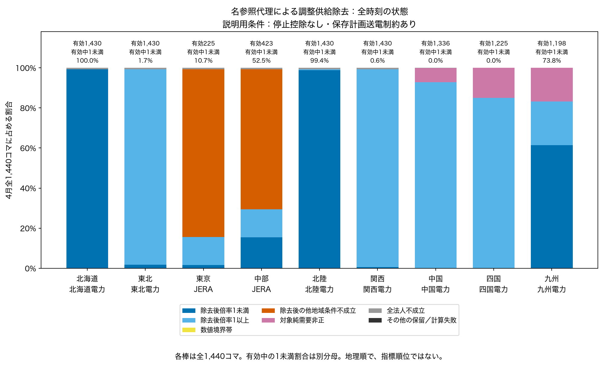
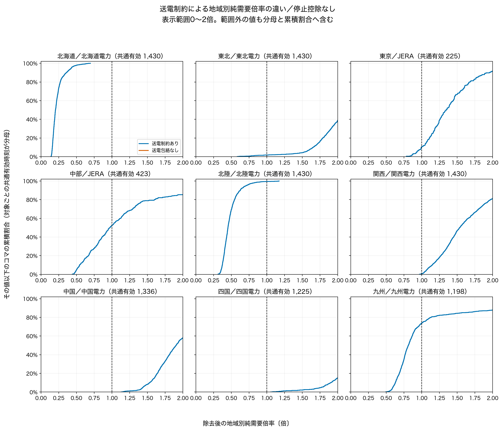
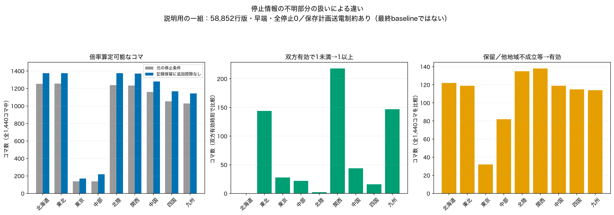
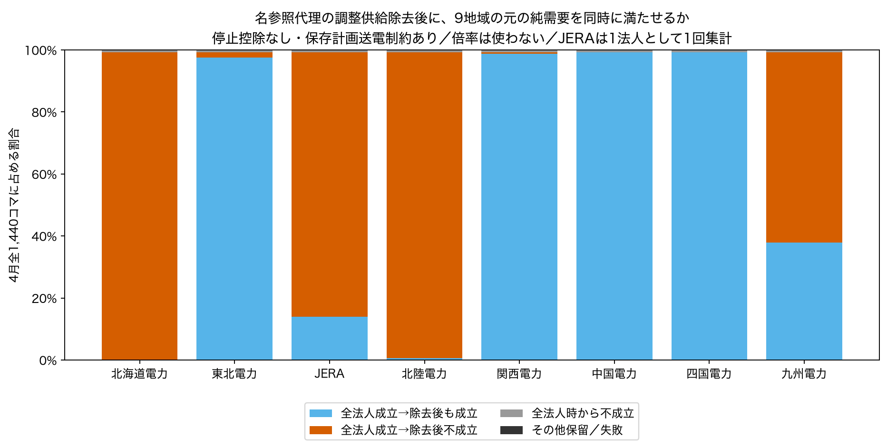

# 4月の企業除去試行を、全時刻・送電制約・停止条件で読む（Issue #42）

## 今回分かったこと

「ある法人の調整可能供給を除いても、他者と地域外からの供給で需要を満たせるか」を、既存の4月試行から比較しました。PV・風力・原子力の実績出力は残しています。

**送電制約と停止情報の不明部分の扱いで、結果は大きく変わります。また、倍率を計算できない時刻も結果の一部です。** 停止控除なし・送電制約ありでは、北海道は倍率算定可能な1,430コマすべてが1未満でした。送電の包絡を解除すると、同じ1,430コマに1未満はありません。この違いは、この限定供給集合から地域間でどれだけ送れると仮定するかに依存します。

停止情報の不明部分を参照上限へ戻す比較では、例えば関西の同一時刻218コマで倍率が1未満から1以上へ変わりました。これは58,852行版・早端・全停止0という説明用の一組での結果です。不明だった設備の利用可能性が確認されたわけではありません。

**JERAを除いて9地域の元の純需要を同時に満たせるのは201コマ、全法人なら成立するのに除去後は満たせないのは1,229コマでした。** 全法人時から不成立の10コマは別です。東京の倍率中央値1.343は、倍率を計算できる225コマだけの値です。4月全体を代表する「代替可能」と読むことはできません。

ここから言えるのは、固定供給・名参照代理・限定集合・保存計画送電条件のもとでの違いです。実際の企業不可欠性、市場支配力、所有・契約の帰属、正式RSI、最終baselineは確定しません。地域を値の大小で順位付けもしません。

## 1．まず、4月全1,440コマを残して見る

説明の出発点は停止控除なし・保存計画送電制約ありです。棒の分母は全1,440コマ。主statusは工程21の優先順位を変更せず、数値が有効な枠だけ倍率1の前後へ分けました。



| 評価地域 | 1未満 | 1以上 | 他地域不成立 | 純需要非正 | 全法人不成立 | 1未満／全時刻 | 1未満／有効時刻（分母） |
| --- | --- | --- | --- | --- | --- | --- | --- |
| 北海道 | 1430 | 0 | 0 | 0 | 10 | 99.31% | 100.00%（1,430） |
| 東北 | 25 | 1405 | 0 | 0 | 10 | 1.74% | 1.75%（1,430） |
| 東京 | 24 | 201 | 1205 | 0 | 10 | 1.67% | 10.67%（225） |
| 中部 | 222 | 201 | 1007 | 0 | 10 | 15.42% | 52.48%（423） |
| 北陸 | 1422 | 8 | 0 | 0 | 10 | 98.75% | 99.44%（1,430） |
| 関西 | 8 | 1422 | 0 | 0 | 10 | 0.56% | 0.56%（1,430） |
| 中国 | 0 | 1336 | 0 | 102 | 2 | 0.00% | 0.00%（1,336） |
| 四国 | 0 | 1225 | 0 | 215 | 0 | 0.00% | 0.00%（1,225） |
| 九州 | 884 | 314 | 0 | 242 | 0 | 61.39% | 73.79%（1,198） |

東京・中部はJERA、それ以外は地域名と同じ従来対象法人です。数値境界帯（1±10⁻⁸）とその他保留／計算失敗はこの説明条件では0件ですが、図・全件表には区分を残しています。全17条件でも境界帯は0件です。

純需要非正と全法人不成立など、理由が重なる場合があります。主区分の件数は排他的です。例えば中国の主区分「全法人不成立」は2コマですが、別の8コマは純需要非正が優先されています。[重複する理由の全件表](qa/overlapping_reason_counts.csv)を別に保持し、重複flagを積み上げません。

## 2．同じ時刻で、送電制約だけを変える

各対象について両条件で倍率が有効な時刻を使いました。全9対象共通の52コマへは絞っていません。曲線は「その倍率以下となるコマの割合」で、左側に寄るほど低い倍率の時刻が多いことを表します。



表示は0〜2倍。2倍を超える値も分母・累積割合に含みます。橙線が見えないパネルは、その値が表示範囲の右側にあります。[全範囲の図](figures/02_network_ecdf_full_range.png)と[表示範囲外の件数・最大値](qa/ecdf_display_windows.csv)を併記します。極端値を削除・切上げしていません。

| 地域 | 共通有効 | 制約ありだけ有効 | 包絡なしだけ有効 | 両方保留 | 倍率中央値：あり／なし |
|---|---:|---:|---:|---:|---:|
| 北海道 | 1,430 | 0 | 10 | 0 | 0.204／27.852 |
| 東北 | 1,430 | 0 | 10 | 0 | 2.173／12.235 |
| 東京 | 225 | 0 | 1,215 | 0 | 1.343／5.200 |
| 中部 | 423 | 0 | 1,017 | 0 | 0.971／8.852 |
| 北陸 | 1,430 | 0 | 10 | 0 | 0.451／26.723 |
| 関西 | 1,430 | 0 | 10 | 0 | 1.535／8.755 |
| 中国 | 1,336 | 0 | 2 | 102 | 1.905／15.858 |
| 四国 | 1,225 | 0 | 0 | 215 | 2.566／50.272 |
| 九州 | 1,198 | 0 | 0 | 242 | 0.812／13.878 |


中央値はそれぞれの行の共通有効時刻だけで比較しています。共通有効時刻では、送電包絡なしの1未満は全対象で0コマでした。例えば北海道は中央値0.204→27.852、中部JERAは0.971→8.852です。包絡なしは、送り側の需要を満たした全国残余上限を自由に送れる比較仮定であり、実際の輸入能力ではありません。

片方だけ有効な時刻を曲線から隠さず、[全status遷移](qa/network_status_transitions.csv)に残しました。東京では「他地域不成立」1,205コマと「全法人不成立」10コマが包絡解除後に有効になります。中部ではそれぞれ1,007・10コマです。制約ありだけ有効な時刻は全対象0でした。純需要非正の時刻は包絡を外しても倍率の分母を変えず保留します。

## 3．停止情報の不明部分をどう扱うと変わるか

既存の停止8条件と、それぞれの記録保留に「追加控除なし」を適用する8条件を、同じ時刻・同じ送電条件で対にしました。17条件は全て残し、下図は58,852行版・早端・全停止0・送電制約ありの一組だけを説明に使います。最終baselineの選択ではありません。



| 地域 | 有効：元→比較 | 双方有効 | 倍率差の中央値 | 1未満→1以上 | 全法人不成立→有効 | 他地域不成立→有効 |
| --- | --- | --- | --- | --- | --- | --- |
| 北海道 | 1,252→1,374 | 1252 | 0.000 | 0 | 119 | 3 |
| 東北 | 1,255→1,374 | 1255 | 0.070 | 144 | 119 | 0 |
| 東京 | 138→170 | 138 | 0.161 | 28 | 0 | 32 |
| 中部 | 138→220 | 138 | 0.177 | 22 | 0 | 82 |
| 北陸 | 1,239→1,374 | 1239 | 0.044 | 2 | 119 | 16 |
| 関西 | 1,233→1,371 | 1233 | 0.054 | 218 | 116 | 22 |
| 中国 | 1,161→1,280 | 1161 | 0.207 | 44 | 119 | 0 |
| 四国 | 1,054→1,169 | 1054 | 0.806 | 16 | 115 | 0 |
| 九州 | 1,029→1,143 | 1029 | 0.462 | 147 | 114 | 0 |

差は「戻した後−元」の倍率で、双方有効な時刻だけの値です。この説明用条件の1以上→1未満は全地域0件。有効時刻自体が増えるので、前後の全有効時刻の中央値や1未満件数をそのまま効果として引き算しません。8組すべて・送電両条件の[比較集計](qa/stop_pair_summary.csv)と[状態遷移](qa/stop_status_transitions.csv)を保存しました。

### 戻す参照上限を、対象企業分と他者分に分ける

毎時刻の内訳は[元の8条件×8法人×1,440コマの全件表](../../data/interim/occto/april_trial_comparison/20261027_comparison_v1/restored_reference_by_entity_time.parquet)に保持します。JERAは1法人として1回です。前記の一組では、戻す全国参照上限の時点別合計は11,392〜18,064.65 MW、時間平均15,274.45 MWでした。

時間平均の例：JERA分1,189.46 MW／その他14,084.98 MW、関西電力分3,013.49 MW／その他12,260.95 MWです。これは瞬時点ごとのMWの時間平均であり、MWhではありません。同じ全国合計を企業ごとに反復しているので、法人間で足しません。

対象企業の上限を戻しても、その企業を除去すると同じ量が除かれます。**除去後に残る上限が増えるのは他者分だけ**です。全92,160法人時刻行で「残る上限の増分＝他者の戻し分」を検証しました。一方、対象企業分の戻しも全法人時の成立判定を変え得るため、元の「全法人不成立」から有効になる変化と分けて読みます。戻すことは利用可能性の確認ではありません。

## 4．JERAの倍率未算定を、9地域同時成立で補う

倍率を使わず、全9地域の元のD−Rを固定して、企業除去後も同時に満たせるかを新たに検査しました。固定R、限定上限、10区間＋北陸フェンスは元と同じです。8法人を各1回扱い、JERAを東京用・中部用の別企業として数えません。



| 除去する名参照代理 | 全法人成立→除去後も成立 | 全法人成立→除去後不成立 | 全法人時から不成立 |
| --- | --- | --- | --- |
| 北海道電力株式会社 | 0 | 1430 | 10 |
| 東北電力株式会社 | 1405 | 25 | 10 |
| 株式会社JERA | 201 | 1229 | 10 |
| 北陸電力株式会社 | 8 | 1422 | 10 |
| 関西電力株式会社 | 1422 | 8 | 10 |
| 中国電力株式会社 | 1430 | 0 | 10 |
| 四国電力株式会社 | 1430 | 0 | 10 |
| 九州電力株式会社 | 546 | 884 | 10 |

全行の分母は1,440コマ。全17供給条件×両送電条件×8法人×1,440コマ＝391,680枠を実行し、入力保留・数値失敗は0件でした。「未知設備の供給力が0」という認定はせず、既存仕様で数値が定義された限定集合を使っています。

JERAでは同じ1,229コマの不成立が、地域別倍率では次のように分かれます。

- 東京：倍率1未満24 ＋ 他地域条件不成立1,205 ＝ **1,229**。
- 中部：倍率1未満222 ＋ 他地域条件不成立1,007 ＝ **1,229**。
- 同時成立201コマは、東京・中部とも倍率1以上の201コマと一致。

東京を評価すると中部の純需要を元の値に固定し、中部を評価すると東京の純需要を固定するため、倍率が有効になる時刻は異なります。東京中央値1.343（225コマ）、中部0.971（423コマ）は、その選ばれた時刻の値です。JERAが全体として満たせた201／1,440コマとは分母が違います。

純需要非正は「倍率の分母として保留」という状態です。同時成立検査ではその元の負値も会計に残せるため、中国・四国・九州では倍率保留でも9地域同時成立となる時刻があります。0倍へ置換しません。[全件の関係検査](qa/multiplier_simultaneous_relationship.csv)で、倍率1未満・他地域不成立が同時成立を示さないこと、全法人判定が既存結果と一致することを照合しました。

## 5．成果物の見方・再現

まず[ノートブック06](../../notebooks/06_april_trial_comparison.ipynb)を開いてください。実行済みの図5枚と集計表があり、再実行すると同じ保存数値から表示します。01・02の手元の編集には触れていません。図はPNGとPDFの両方を `figures/` に保存しています。

新しい比較版は `data/interim/occto/april_trial_comparison/20261027_comparison_v1/`（Git管理外）。元の工程21固定版は上書きしていません。

| 表 | 含むもの |
|---|---|
| `all_times_with_display_categories.parquet` | 440,640枠、工程21の全元列＋表示区分 |
| `overlapping_reason_flags.parquet` | 全枠の重複する理由flag |
| `reference_network_pairs_all_times.parquet` | 説明用の全12,960対。有効以外も保持 |
| `paired_stop_cases_all_times.parquet` | 停止8組×9対象×両送電×1,440＝207,360対 |
| `restored_reference_by_entity_time.parquet` | 戻した全国・対象企業・他者の参照上限MW、92,160行 |
| `nine_area_simultaneous_after_removal.parquet` | 391,680枠、8法人の同時成立結果 |
| `all_firms_simultaneous_baseline.parquet` | 17条件×両送電×1,440＝48,960枠の全法人再検査 |
| `multiplier_simultaneous_relationship.parquet` | 440,640枠の地域別倍率と同時成立の対応 |
| `simultaneous_solution_samples.parquet` | 成立解の発電・潮流・上限・残差の検証標本 |

再計算は次の2本です。新しい出力先を指定し、固定版へ上書きしません。ノートブックにも再構築用セルがあります（既定は保存版の閲覧のみ）。

```sh
python scripts/interpret_april_trial.py --output /path/to/shared-repo/data/interim/occto/april_trial_comparison/new-version --report /path/to/new-review
python scripts/plot_april_trial_comparison.py --output /path/to/shared-repo/data/interim/occto/april_trial_comparison/new-version --report /path/to/new-review
pytest -q
ruff check .
```

変数定義は[出力列対応表](qa/output_column_dictionary.csv)、入力・出力SHAは[比較版manifest](../../metadata/april_trial_comparison_manifest_20261027.json)、検証は[QA](qa/verification.json)へ。結合率100%、未一致・行増殖・暗黙のdropは0。pytest **340 passed**、ruff通過。原本203件・参考原本39件・既存固定100成果物と工程18〜21の原本/出力SHAを照合し、元440,640行の全元列・全セル・宣言型も一致しました。再現ノートブックの全コードセルを実行検証しました。倍率差は無単位、復帰上限はMW、時刻はAsia/Tokyo・1日48コマです。

## 6．今回の数値から残る研究判断

1. **停止の不明部分の重み付け。** 関西では同一時刻218コマが1を跨ぎます。元の停止条件と追加控除なし比較を併記することを推奨します。どちらかを利用可能供給の真値とせず、重視する範囲の選択はユーザー判断です。
2. **倍率を算定できない時刻を含めた比較方法。** JERAでは除去後不成立1,229コマが地域によって「1未満」と「他地域不成立」に分かれます。全時刻の状態と9地域同時成立を先に示し、倍率曲線は対象ごとの共通有効時刻に限る構成を推奨します。未算定を0へ置換した地域順位は作りません。
3. **送電条件への条件付けをどこまで研究結論に含めるか。** 北海道の中央値0.204／27.852の差は大きく、制約を外した仮定が結論を変えます。保存送電条件ありを説明の出発点に、同一時刻の包絡解除を比較として残すことを推奨します。実運用の制約や入札時情報を再現したという採用判断はしません。

今回の供給集合・名参照代理は全設備や契約供給を網羅しません。固定Rは後日のPV・風力・原子力実績、送電条件は保存翌々日計画、容量はsnapshot参照値一定です。公表需要のみを満たし、観測充電の再現は要求しない既存条件も残ります。4月の結果を通年へ一般化せず、回帰、企業不可欠性認定、全供給除去、最終baseline確定、問い合わせ、PR mergeは行っていません。
