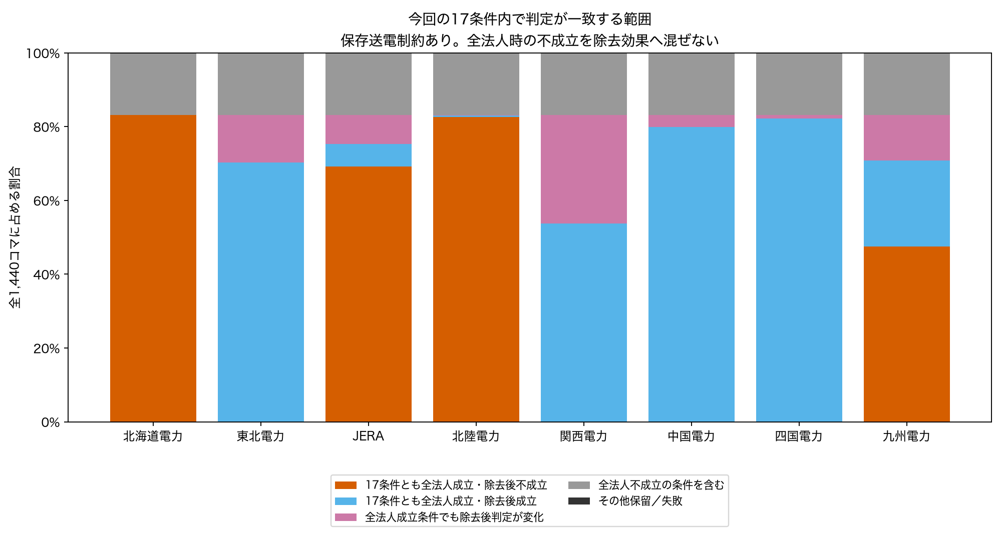
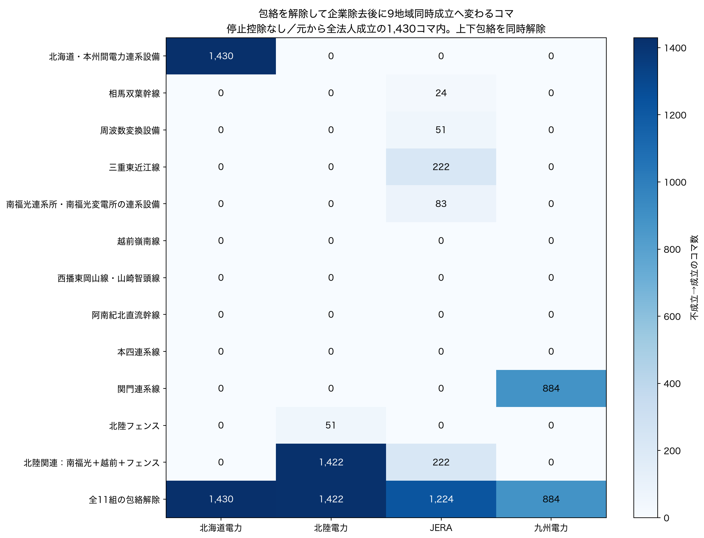

# 4月：停止条件を変えても残る特徴と、代替供給を制限する条件（Issue #42）

## 今回分かったこと

**今回の17供給条件のどれを使っても、北海道・北陸・JERA・九州には、企業の調整供給を除くと需要を満たせない時刻が残りました。** ただし、同じ結論になる時刻の多さは異なります。全17条件で企業を除く前は成立し、除去後だけ不成立になるのは、北海道1,198、北陸1,190、JERA997、九州685コマです。4月全1,440コマを残して数えました。

**送電の上限・下限（以下「包絡」）を変えると結果も変わります。** 停止控除なしでは、北本だけの包絡解除で北海道の1,430コマ、関門だけで九州の884コマが同時成立へ変わりました。北陸はフェンスだけの解除では51コマですが、南福光・越前・フェンスの重なりをまとめて解除すると1,422コマです。「一つ外して変わらなかった＝重要でない」とは読めません。

**JERAは一つの区間だけでは説明できません。** 単独解除で成立へ変わるのは最大222コマですが、全包絡解除では、元から全法人が成立していた1,430コマのうち1,224コマが変わります。別に5コマは、JERA除去後の全国の限定上限自体が純需要より小さく、送電包絡を全て外しても満たせません。

停止保留の扱いによって変わる部分もあります。対応する8組の比較で、全法人が前後とも成立する同じ時刻に限ると、JERAは34〜113コマ、九州は144〜179コマが除去後の不成立から成立へ変わります。北海道は0、北陸は0〜2コマでした。ここで「条件を変えても残る」と言える範囲は今回の17条件内です。モデル全般の頑健性や実際の企業不可欠性を確認した意味ではありません。

## 1．17条件の全時刻を比べる

各時刻・法人について17供給条件を比べ、主区分を重複させずに表示しました。送電あり／なしは別に集計しています。図は保存送電制約あり、各法人の分母は全1,440コマです。



| 名参照代理 | 全条件で全法人成立・除去後不成立 | 全条件で全法人成立・除去後成立 | 全法人成立条件でも除去後判定が変化 | 全法人不成立の条件を含む |
| --- | --- | --- | --- | --- |
| 北海道電力 | 1198 | 0 | 0 | 242 |
| 東北電力 | 0 | 1013 | 185 | 242 |
| JERA | 997 | 88 | 113 | 242 |
| 北陸電力 | 1190 | 6 | 2 | 242 |
| 関西電力 | 0 | 774 | 424 | 242 |
| 中国電力 | 0 | 1150 | 48 | 242 |
| 四国電力 | 0 | 1184 | 14 | 242 |
| 九州電力 | 685 | 334 | 179 | 242 |

「比較範囲が異なる」242コマの内訳は、全17条件とも全法人時から不成立10コマと、条件によって全法人時の判定が変わる232コマです。これらを企業除去だけによる不成立と同列には数えません。主区分ではこの242コマを先に分離しましたが、その中の比較可能条件でも除去後判定が変わることがあります。重複する[条件比較flag](qa/overlapping_consistency_flags.csv)も残しています。その他保留／失敗は全法人・両送電条件とも0件でした。

北海道は、全法人が成立した条件では除去後成立が17条件とも0コマです。北陸の除去後成立は条件ごとに6〜8コマ、JERAは88〜201、九州は334〜546コマでした。**有効な比較時刻も条件ごとに変わるため、この最小〜最大の差をそのまま停止処理の効果とはしません。**

[法人×17条件の図](figures/01_all17_removal_failure.png)は「全法人成立→除去後不成立」の件数と、各条件の全法人時からの不成立件数を併記します。成立・不成立の全内訳は[全8法人・17条件・両送電の表](qa/all17_simultaneous_summary.csv)。[重点4法人の時刻順の図](figures/04_focus_time_states.png)と全23,040法人時刻行を保持し、全条件共通時刻だけに絞っていません。

### 対応する停止条件ペアで読む

元の停止8条件と、それぞれの「記録保留に追加控除なし」を同時刻で比較しました。新しい停止条件は追加していません。

| 法人 | 前後とも全法人成立の時刻で、除去後不成立→成立（8組の範囲） | 全法人時から不成立→成立（8組の範囲） |
| --- | --- | --- |
| 北海道電力 | 0〜0 | 118〜226 |
| 北陸電力 | 0〜2 | 118〜226 |
| JERA | 34〜113 | 118〜226 |
| 九州電力 | 144〜179 | 118〜226 |

後者は各法人で同じ全法人判定の変化であり、法人間で足しません。前者と分け、[全停止ペアの表](qa/stop_pair_simultaneous_summary.csv)・全184,320対を保存しました。

## 2．どの送電包絡を外すと変わるか

停止控除なしを使い、個別10区間＋北陸フェンスの11組について、上下包絡を一組ずつ解除しました。9地域の需要・固定R・供給上限・接続は保持しています。解の潮流を実潮流として使ったり、一つの解で上限に達した区間を唯一の原因としたりしていません。



図の件数は、元から全法人成立の1,430コマ内で「除去後不成立→成立」となった数です。元から全法人不成立の10コマも、[全時刻表](qa/release_simultaneous_summary.csv)では別に保持します。例えばJERAの全包絡解除は図では1,224コマですが、10コマの比較範囲外も含む変化は1,234コマです。

| 解除対象（上下両包絡） | 北海道電力 | 北陸電力 | JERA | 九州電力 |
| --- | --- | --- | --- | --- |
| 北海道・本州間電力連系設備 | 1430 | 0 | 0 | 0 |
| 相馬双葉幹線 | 0 | 0 | 24 | 0 |
| 周波数変換設備 | 0 | 0 | 51 | 0 |
| 三重東近江線 | 0 | 0 | 222 | 0 |
| 南福光連系所・南福光変電所の連系設備 | 0 | 0 | 83 | 0 |
| 越前嶺南線 | 0 | 0 | 0 | 0 |
| 西播東岡山線・山崎智頭線 | 0 | 0 | 0 | 0 |
| 阿南紀北直流幹線 | 0 | 0 | 0 | 0 |
| 本四連系線 | 0 | 0 | 0 | 0 |
| 関門連系線 | 0 | 0 | 0 | 884 |
| 北陸フェンス | 0 | 51 | 0 | 0 |
| 南福光＋越前＋北陸フェンス | 0 | 1422 | 222 | 0 |
| 全11組 | 1430 | 1422 | 1224 | 884 |

北陸の追加診断は、既存の包含関係がある南福光・越前・北陸フェンスの3組だけです。フェンスは `f_南福光 − f_越前` を同時に制約し、別の輸入能力として加算しません。JERAの単独解除と全解除との差が大きくても、根拠のない全組合せ探索や、任意のフェンス統合は行いませんでした。

### 地域別純需要倍率も、同じ時刻で比較する

[全解除条件の倍率比較](qa/release_multiplier_summary.csv)・[全status遷移](qa/release_multiplier_status_transitions.csv)を保存しました。東京・中部は別評価地域、9地域同時成立のJERAは1法人として1回です。

| 評価地域 | 解除対象 | 共通有効コマ | 同時刻倍率差の中央値 | 共通時刻で倍率が増えたコマ | 新たに有効になるコマ |
| --- | --- | --- | --- | --- | --- |
| 北海道 | 北海道・本州間電力連系設備 | 1430 | 5.290 | 1430 | 0 |
| 北陸 | 北陸フェンス | 1430 | 0.138 | 1199 | 0 |
| 北陸 | 北陸3組 | 1430 | 9.964 | 1430 | 0 |
| 東京 | 相馬双葉幹線 | 225 | 0.667 | 225 | 0 |
| 中部 | 三重東近江線 | 423 | 2.446 | 423 | 0 |
| 九州 | 関門連系線 | 1198 | 2.160 | 1198 | 0 |

差は解除後−解除前で、共通有効時刻だけの値です。倍率が増えたとする数値検査幅は10⁻⁷で、値自体を丸めたり切り上げたりしていません。例えば三重東近江線の解除は、東京の倍率を新たに計算できる時刻を1,205コマ増やしますが、JERAの元の9地域純需要を同時に満たせる変化は222コマです。「倍率を計算できた」と「元の全需要を満たした」は別の条件です。

[方向・係数・範囲表](qa/constraint_direction_scope.csv)に11組の符号と4月の適用範囲を記録しました。個別区間は既存EDGESの順方向正、逆向きは下包絡で制限します。北陸フェンスの正は中部→北陸と関西→北陸の組合せです。原値の絶対値化や符号変更ではなく、制約行を外す比較操作です。物理的増強効果・実混雑・政策効果へ読み替えません。

## 3．供給上限の低下と、情報保留による集合縮小を分ける

[全881,280行の地域・時刻・重点法人別台帳](../../data/interim/occto/april_constraint_diagnosis/20261027_constraints_v2/focus_regional_supply_scope_all_times.parquet)へ、除去前の既知上限、除去量、残る上限、停止保留を戻す他者分、集合外件数、参照容量・容量不明を併記しました。

対となる比較条件を用いると、除去後に残る他者上限の低下を次のように正確に分解できます。

`控除なし上限 − 元停止条件上限 =（控除なし上限 − 保留復帰後上限）＋（保留復帰後上限 − 元停止条件上限）`

前半は保留を戻しても残る数値シナリオの上限低下、後半は記録保留のため計算集合が縮小していた分です。**前半も実際の停止損失の確定値ではありません。** 参照容量と公表予定・平均低下量の仮定に基づく差です。対象企業自身を戻した分は企業除去で消えるので、ここでは他者分だけを計算します。

58,852行版・早端・全停止0の一組の例（全国の時点別MWを4月で時間平均）：

| 除去する法人 | 保留を戻しても残る低下MW | 記録保留で集合外だった他者分MW | 元条件の他者上限低下合計MW |
| --- | --- | --- | --- |
| 北海道電力 | 33,689.42 | 14,348.51 | 48,037.92 |
| 北陸電力 | 33,433.83 | 15,034.45 | 48,468.27 |
| JERA | 23,652.32 | 14,084.98 | 37,737.30 |
| 九州電力 | 32,384.05 | 13,828.20 | 46,212.24 |

全8組の[分解集計](qa/supply_decomposition_summary.csv)と414,720地域法人時刻行を保存しました。これはMWの時間平均であり電力量MWhではありません。他者集合は法人ごとに違うので法人間で合算しません。

停止控除なしでも、9地域の観測がある非固定442ラベルのうち計算集合外は73ラベルでした。集合外の使用可能参照値の既知部分和は1,534.8 MW、元台帳の容量セルまで遡ると既知部分和は5,242.8 MWですが、そのうち設備範囲・期間等を満たさない値は上限へ戻していません。使用可能な参照値が不明62ラベル、元台帳の容量値も不明54ラベルです。別に9地域の非固定registry446ラベル中、4月元観測行がない4ラベルを件数で保持し、unit日や供給力は生成していません。

容量coverageの全国分母は確定できないため、割合は出しません。地域別・全17条件の[供給範囲表](qa/supply_scope_summary.csv)を残しています。北海道の設備対応が高いことも、全国や契約供給の網羅性とは別です。

### 全国上限の不足と、地域への送達・固定出力の吸収を分ける

停止控除なしのJERA除去後には、4月1日のperiod36〜40で全国の限定上限が純需要に1,123.93〜4,562.93 MW足りません。ここは包絡を全て解除しても解決しない入力集合の不足です。

その他の不成立は、全国合計だけでは判別できません。重点4法人の全17条件の送電制約あり不成立枠に、既存と同じ「不足＋余剰を最小にする」診断用LPを適用しました。診断用過不足は正式需要・供給へ混ぜず、数値は[切り分け表](qa/focus_slack_diagnosis_counts.csv)・全件Parquetへ保持します。

停止控除なしでは、全法人時から不成立の10コマには、重点4法人とも局所的な吸収不足を表す余剰変数が現れました。不足変数も同時に現れるのは北海道10、北陸9、JERA1、九州0コマです。企業除去による不成立と混ぜません。全法人成立の時刻に限った除去後の内訳は次のとおりです。

| 除去対象 | 全国の限定上限不足 | 地域への送達制約（診断不足のみ） | 不足と局所吸収の両方 | 局所吸収・輸出制約（診断余剰のみ） |
| --- | --- | --- | --- | --- |
| 北海道電力 | 0 | 1430 | 0 | 0 |
| 北陸電力 | 0 | 1422 | 0 | 0 |
| JERA | 5 | 1224 | 0 | 0 |
| 九州電力 | 0 | 884 | 0 | 0 |


全国合計の固定出力超過は全17条件の重点4法人で0件でしたが、局所的な余剰・輸出制約は別です。後者を全国合計の正負だけから排除せず、L1診断の余剰変数を併記しました。

この過不足の地域配分は一意な原因の所在地ではありません。全法人時から不成立の枠も別列で保持します。公表需要のみを満たして観測充電の再現は要求しない既存条件なので、固定出力を吸収できないことを実系統の需給不成立とは呼びません。

## 4．代表時刻を数字で読む

選定規則は「17条件全てで全法人成立・除去後不成立となる最初の時刻」。重点4法人はいずれも2025-04-01 period1（00:00〜00:30）でした。価格は選定にも診断にも使用しません。[選定記録](qa/representative_selection.csv)・[各例の9地域会計](qa/representative_regional_account.csv)・[11組の制約値](qa/representative_constraints.csv)を保存しました。下表は説明のため停止控除なしを用います。

| 除去対象／確認範囲 | 実績需要D MW | 固定R MW | 純需要D−R MW | 残る域内上限MW | 境界の流入包絡から得る上限MW | この切り口で残る差MW |
|---|---:|---:|---:|---:|---:|---:|
| 北海道電力／北海道 | 3,323 | 256 | 3,067 | 250 | 北本の東北→北海道237 | 2,580 |
| 北陸電力／北陸 | 3,034 | 7 | 3,027 | 486 | 北陸フェンス700 | 1,841 |
| 九州電力／九州 | 8,996 | 3,070 | 5,926 | 3,554 | 関門の中国→九州250 | 2,122 |
| JERA／東京 | 28,819 | 101 | 28,718 | 15,915.97 | 他地域との同時条件に依存 | 下の2地域の会計へ |
| JERA／中部 | 13,194 | 34 | 13,160 | 3,642 | 同上 | 同左 |

これは9地域モデルを保ったまま、必要条件を数字で確認する表です。北本や関門の公表値を、無条件に地域輸入能力と認定した表ではありません。

JERA例では、東京・中部の純需要は合計41,878 MW、残る域内上限は19,557.97 MWで、差は22,320.03 MWです。この2地域の外側から入る境界の包絡は、相馬3,860＋三重逆方向2,000＋南福光逆方向300＝6,160 MW。残る差16,160.03 MWは、診断用の最小過不足合計と一致します。周波数変換設備は東京・中部の**内側**を移すので、この2地域の会計に外からの供給として二重計上しません。

東京・中部を統合評価地域へ変更したものではなく、同じ9地域モデルの会計を説明する切り口です。診断解では東京8,192.03・中部7,968 MWへ不足が配分されましたが、FCで割当てを変えられるため、どちらが実際の原因地域かを確定する値ではありません。

## 5．次の判断と、論文の中心結果候補

- **中心結果候補：限定集合での代替供給は地域間の接続条件に依存する。** 北海道1,198、北陸1,190コマは17条件共通で除去後不成立。北陸では単独フェンス解除51に対し包含群解除1,422という重なりも示せます。今回の17条件内の一致と、モデル内の制約寄与として提示する案を推奨します。
- **停止条件の選択が結論を動かす範囲。** JERAの34〜113、九州の144〜179コマは対応ペアで不成立→成立に変わります。単一条件を先に選ぶより、17条件共通部分とこの変化部分を併記する構成を推奨します。242コマの全法人比較範囲の違いも残します。
- **帰属代理をどこまで研究の対象とするか。** 現在のJERAは台帳名参照83ラベル、停止控除なし36,340.9 MWの全地域同時除去です。共同事業・契約配分をどう扱うかで除去入力は変わり得ますが、今回別代理の数値を作ったわけではありません。「この名参照代理下の構造評価」とするか、別の帰属根拠を求めるかが研究判断です。東京・中部の全設備をJERAへ移す、EP・ミライズを0供給とする判断はしていません。

これらを最終baselineへ昇格させず、今回の結果として区切ります。PV・風力・原子力を固定し、実績発電を上限から再控除せず、対象企業の名参照調整供給だけをモデル内全地域から除く定義は不変です。全供給除去、回帰、実際の企業不可欠性の認定、年間取得、問い合わせ、PR mergeは行いません。

## 成果物・再現・検証

[実行済みノートブック07](../../notebooks/07_april_constraint_diagnosis.ipynb)で図4枚と比較表を確認できます。PNG/PDFは `figures/`、全件表は `data/interim/occto/april_constraint_diagnosis/20261027_constraints_v2/`（Git管理外）です。v1は初期点検を中断した途中出力、採用版はv2です。旧工程21/22の固定版は上書きしません。

```sh
python scripts/diagnose_april_constraints.py --output /path/to/shared-repo/data/interim/occto/april_constraint_diagnosis/new-version --report /path/to/new-review
python scripts/diagnose_april_constraint_slacks.py --output /path/to/shared-repo/data/interim/occto/april_constraint_diagnosis/new-version --report /path/to/new-review
python scripts/plot_april_constraints.py --output /path/to/shared-repo/data/interim/occto/april_constraint_diagnosis/new-version --report /path/to/new-review
pytest -q
ruff check .
```

全17条件・両送電条件・全1,440時刻を保持。既存の同時成立391,680枠・倍率440,640枠は値と型を照合しました。新しい解除結果は4法人×14解除条件×1,440＝80,640同時成立枠、5評価地域法人対×14×1,440＝100,800倍率枠。14は元条件・単独11・包含群1・全解除1であり、新しい停止条件ではありません。主結合は100%、未一致・行増殖・暗黙のdrop0。供給範囲の復帰量は元8条件だけが適用対象で、その他9条件466,560行は構造上の未適用nullとして区別します。復帰量照合は全行比47.06%、適用される8条件内では100%です。[適用範囲と結合件数](qa/return_pair_join_statistics.csv)を別に保存しました。

[変数辞書](qa/output_column_dictionary.csv)・[入力/出力SHAと版](../../metadata/april_constraint_diagnosis_manifest_20261027.json)・[独立検証](qa/independent_validation.json)・[テスト/不変性検証](qa/verification.json)へ。pytest **347 passed**、ruff通過。原本・旧固定版のSHA、全日48コマ・キー・型・null・解除による単調性・停止集合分解・代表解残差を検証しました。
