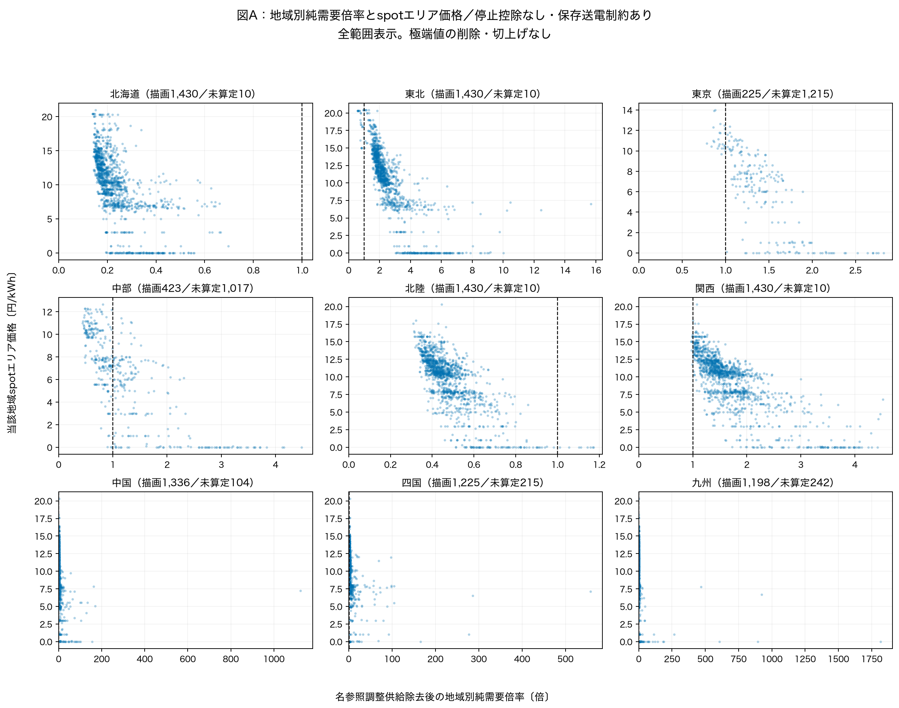
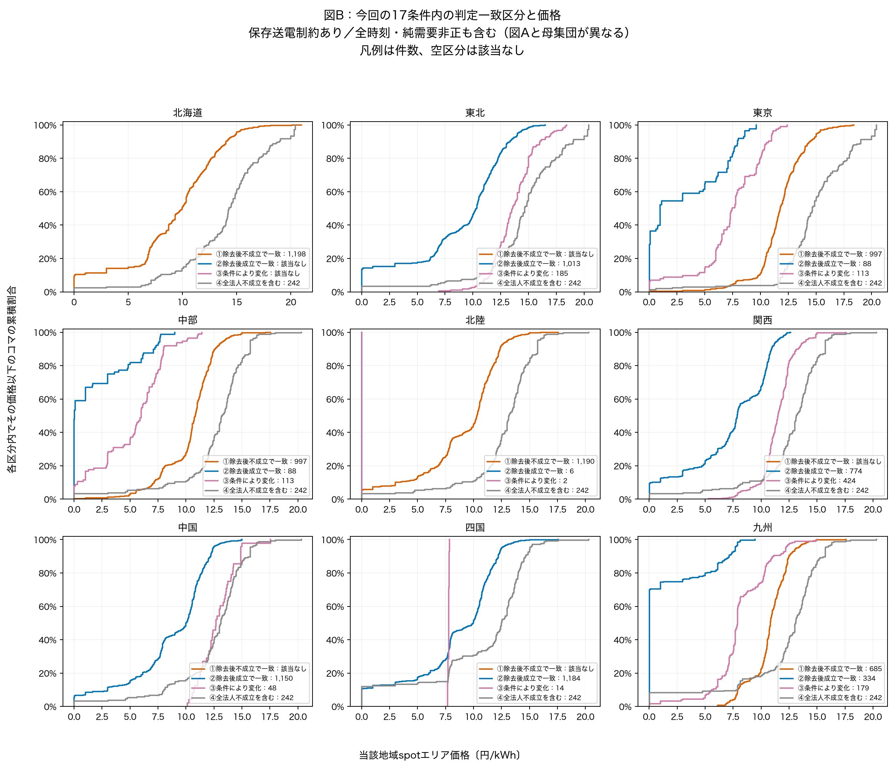
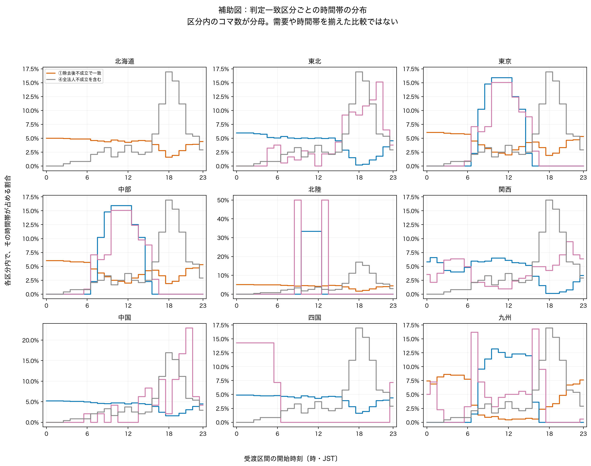

# 4月の入力2点の確認と、実際の価格との記述的な接続（Issue #42）

## 今回分かったこと

**北海道の462 MWと250 MWは、設備集合の採用範囲が違うためでした。** 室蘭中央5号100 MW・釧路1号112 MWは、設備対応や容量は参照できますが、元燃種が空欄です。固定PV・風力との非重複を原燃種で確認できる設備に限った後工程では、この2設備を保留しています。停止や北海道電力への名寄せが理由ではなく、自動復帰もしていません。

**送電の式は、追加の空きと全体の再配分を区別した条件付きシナリオとして維持します。** 北本237 MWは運用容量そのもの900 MWではありません。逆向きの元符号で `−900−(−663)−0=−237` とした保存包絡です。保存マージンや広域調整枠を使わない範囲で再配分するという仮定を残し、実際の送電可能量と認定しません。

**価格には並んで見える違いがありますが、一対一には対応しません。** 九州では17条件で除去後不成立が一致する685コマの価格中央値10.84円に対し、成立が一致する334コマは0.01円でした。一方、北海道には倍率1未満でも0.01円、中国・四国には倍率1以上でも20.30円のコマがあります。需要・純需要・時間帯の違いもあるため、企業除去が実際の価格を変えた効果ではありません。

今回は旧版を固定した探索的な価格接続です。最終baseline、企業不可欠性、売り渋り、市場支配力の行使は認定しません。

## 1．北海道：3設備のどこが変わったか

| 元設備 | 台帳記載法人 | 以前の参照容量MW | 今回の調整上限への採用 | 理由 |
|---|---|---:|---|---|
| 苫小牧共同火力3G・単独 | 北海道パワーエンジニアリング | 250 | 採用。北海道電力除去後も残る | 元燃種「火力（石油）」、対応点検済み、正の参照値。別法人名を親会社へ統合しない |
| 室蘭中央5号 | 日本製鉄 | 100 | 保留 | 元燃種空欄、`held_fuel_scope_unresolved`。対応と容量自体は点検済み |
| 釧路火力・1 | 釧路火力発電所 | 112 | 保留 | 同上。名前から燃種・PV/風力との非重複を推測しない |

[3設備の全追跡表](qa/hokkaido_supply_set_reconciliation.csv)には設備キー、台帳行、元燃種、期間/役割/使用状態、代表時刻の上限、4月の元観測セル数を保持しました。3設備とも4月1,440観測があり、期間外や停止由来の保留で212 MWが消えたわけではありません。別名の対象企業代理へ移したものでもありません。苫小牧共同3Gが残ることも、独立した競争者と確認した意味ではなく、既存の台帳名代理を維持した結果です。

以前は「制度対象外と名参照できる3設備」の参照容量差を描きました。今回は固定出力との重複を避けた限定調整集合から対象企業名の上限だけを除きます。**以前の横軸は容量−実績平均出力、今回の上限は実績発電を差し引かない参照上限**という指標上の違いも、設備集合の差212 MWとは別にあります。

既存の採用ルールと実装は一致しており、処理ミスとしての再計算は不要です。今後この2ラベルを使うなら、PV/風力との非重複や分析上の役割をどう根拠付けるかが採用判断です。対象は計212 MWで、単に容量を足す算術なら代表時刻250→462 MWですが、今回この復帰条件や倍率・成立件数は作っていません。

## 2．送電上限：何を固定し、何を再配分しているか

[OCCTO概況 図2-17・表2-7（物理36／本文33）](https://www.occto.or.jp/houkokusho/2025/files/denryokujukyuu_2024_250910.pdf)は、流せる容量の上端、緊急時等に管理するマージン、登録された純計画潮流、残る空容量を区別します。広域周波数調整の枠を空容量から控除する説明もあります。これは2024年度実績の説明であり、FY2025各保存値の設定理由・利用権まで証明する資料ではありません。

[系統情報操作マニュアル 表2-8（物理43〜44）](https://www.occto.or.jp/assets/occtosystem2/files/250306_keitoujouhou.pdf)で、翌々日/策定・MW・順逆・出典時刻の列を確認しました。既存原本を優先し、前者の参考PDF1件を追加保存しました。年間時系列データの取得ではありません。[確認水準と追加仮定](../../metadata/research/april_price_input_review_20261027.json)。

元CSVの同じ符号軸で、`C=運用容量、M=マージン、W=広域調整枠、P=計画潮流、A=空容量` とします。

- **追加の余地**：`A=C−M−W−P`。登録済みPを前提にした残りです。
- **旧モデルの包絡候補**：`L/U=C−M−W=A+P`。計画P自体を固定せず、モデルの純移送fをこの内側で再配分します。
- 逆方向は原負値のまま下限L。例えば東北→北海道の表示237は`−L`であり、全ソースを絶対値化したものではありません。

代表時刻2025-04-01 period1＝00:00〜00:30。元CSV「時刻」は区間終端00:30です。出典ファイルは全行とも `auto_occto_interconnector_capacity_dayahead2_planned_20250401_20250407.csv`、翌々日・策定です。

| 元区間 | 元方向 | 元論理行 | C | M | W | P | A | 旧モデルL/U（MW） |
| --- | --- | --- | --- | --- | --- | --- | --- | --- |
| 北海道・本州間電力連系設備 | 逆方向 | 3 | -900 | -663.0 | 0 | 0 | -237.0 | -237.0 |
| 関門連系線 | 順方向 | 6050 | 380 | 130.0 | 0 | 0 | 250.0 | 250.0 |
| 相馬双葉幹線 | 順方向 | 674 | 3860 | 0.0 | 0 | 0 | 3860.0 | 3860.0 |
| 三重東近江線 | 逆方向 | 2019 | -2000 | 0.0 | 0 | 0 | -2000.0 | -2000.0 |
| 南福光連系所・南福光変電所の連系設備 | 逆方向 | 2691 | -300 | 0.0 | 0 | 0 | -300.0 | -300.0 |
| 周波数変換設備 | 順方向 | 1346 | 1350 | 600.0 | 0 | 0 | 750.0 | 750.0 |
| 周波数変換設備 | 逆方向 | 1347 | -1350 | -600.0 | 0 | 0 | -750.0 | -750.0 |

[一つの追跡表：元22行・時刻・方向・元値・式・URL/取得版への参照](qa/representative_network_trace.csv)には、両方向・フェンスも含め、元ファイル、SHA付き元行ID、更新/取得時刻と仮定を保持しています。元CSVの全19列を全22行で独立照合しました。

東京・中部の外側の境界は、相馬順方向3,860＋三重逆方向2,000＋南福光逆方向300＝6,160 MWという保存包絡の必要条件です。FC±750は両地域の内側なので、外部供給へ足しません。各地域の評価自体は統合しません。

4月全31,680系統行で上のAの数値式が一致し、Pは全行0でした。しかし、**P=0でAとL/Uの数字が一致しても、「追加送電の余地」と「計画を再配分する包絡」の意味は同じになりません。**

**判定：条件付きシナリオとして維持。今すぐ数値修正する根拠は得られませんでした。** 保存されたM（使用計画分控除後の表示）とWを固定し、残る枠内で9地域の純移送を再配分する仮定です。緊急時のマージン利用、既存契約の変更権、実系統内部の制約、市場時点の情報集合を再現しません。物理的な全送電上限の推定が目的なら、この仮定の採否・枠の扱いを別に決める必要があります。実潮流・絶対値・価格に合わせた上限置換はしていません。

## 3．4月価格は何行を接続したか

| 表 | 行数・粒度 | 結合 |
|---|---|---|
| `april_price_observations.parquet` | 9地域法人対×1,440＝12,960価格観測。元spot43列保持 | 日付×periodで感応度基準と1対1、地域展開後キー一意 |
| `all_scenarios_with_spot_prices.parquet` | 17供給条件×両送電×12,960＝440,640行。元倍率全列・status保持 | 必須価格キー100%、未一致0、増殖0 |
| `consistency_with_prices_by_network.parquet` | 両送電×12,960＝25,920行 | 17条件一致区分と需要会計の対応100% |

同じ12,960価格を34条件に反復しているので、440,640個の独立市場観測とは数えません。JERAの同時成立は1法人の結果を東京・中部の異なる地域価格へ対応させ、JERAを分割していません。

実績`system_price_market`はspotの`system_price`そのもの、感応度の`system_price_sensitivity_base`は別系列です。FY2025の2,271時刻、4月の113時刻の不一致は無修正。全国共通系列の地域反復も独立観測ではありません。エリア価格が図の縦軸で、system priceへ置換していません。

## 4．図A：倍率と価格はどう並んだか



停止控除なし・送電制約あり、1点＝1コマ、9地域を地理順で示します。倍率1の線は分類の基準です。倍率が未算定の時刻は0にせず、[全status件数と価格分布](qa/scatter_status_price_distribution.csv)に残しました。北海道の有効点1,430に対し、東京JERAは225、中部JERAは423で、有効時刻は地域ごとに異なります。

[倍率0〜2の拡大図](figures/02_multiplier_price_near_one.png)と[表示範囲外の件数・最大倍率](qa/scatter_display_windows.csv)も保存しました。極端値は削除・切上げせず、全範囲図と本体に残ります。小さい正の純需要では倍率が大きくなるため、横軸の値だけで順位にしません。

### 単純な対応にはならない例

全9地域について「有効・1未満の最小価格」「有効・1以上の最大価格」を機械的に記録しました。同値は最初の時刻。閾値は元の倍率1だけで、新しい高価格・低需要の閾値は選んでいません。[18枠の記録・該当なしも保持](qa/descriptive_extreme_examples.csv)。これは極端な観測例を説明する規則で、代表的な価格効果の推定ではありません。

- 北海道：4/9 period25、倍率0.347・価格0.01円。条件付き代替が難しい判定でも、価格が高いとは限りません。
- 中国・四国：4/23 period19、倍率2.010／2.515でも価格はともに20.30円。他の地域の状況・入札・需要等を統制していません。
- 九州：1未満の最小価格6.10円に対し、1以上の最大価格15.00円。同じ地域でも単調な一対一対応ではありません。

## 5．図B：17条件の一致区分ごとの価格



地域内で各区分の価格分布を比較する累積曲線です。件数0は「該当なし」と表示し、空区分の価格を0にしません。①＝全条件で全法人成立・除去後不成立、②＝同じく除去後成立、③＝全法人成立条件でも除去後が変化、④＝全法人不成立の条件を含む、です。

| 地域 | ①件数／中央値 | ②件数／中央値 | ③件数／中央値 | ④件数／中央値 |
| --- | --- | --- | --- | --- |
| 北海道 | 1,198／9.940 | 該当なし | 該当なし | 242／14.290 |
| 東北 | 該当なし | 1,013／10.330 | 185／13.560 | 242／14.670 |
| 東京 | 997／11.780 | 88／1.000 | 113／7.480 | 242／14.670 |
| 中部 | 997／10.820 | 88／0.020 | 113／6.000 | 242／13.230 |
| 北陸 | 1,190／10.305 | 6／0.010 | 2／0.010 | 242／13.160 |
| 関西 | 該当なし | 774／7.870 | 424／11.500 | 242／13.160 |
| 中国 | 該当なし | 1,150／10.000 | 48／12.680 | 242／13.115 |
| 四国 | 該当なし | 1,184／9.970 | 14／7.775 | 242／12.505 |
| 九州 | 685／10.840 | 334／0.010 | 179／7.890 | 242／13.095 |

単位は円/kWh。中央値の表示丸めは原価格を変更しません。[中央値・25/75%点・最小/最大・件数の全表](qa/state_price_and_covariate_distribution.csv)とノートブックに、実績需要MW・純需要MW・時刻も併記しました。図Bは全時刻を使うため、図Aで倍率保留となる純需要非正も含みます。北海道は②③がなく、「不成立群と成立群の価格差」は計算できません。北陸の成立群は6コマしかなく、広い比較対象とは扱えません。

東京・中部では①の中央値11.780／10.820円に対し②は1.000／0.020円、九州は10.840／0.010円でした。ただし、これらは時間帯や純需要が揃った比較ではなく、価格の差を企業除去の効果とするものではありません。④は除去前からの入力成立性が条件で変わる時刻を含むため、企業除去後不成立群へ足しません。

九州の②334コマのうち226コマは純需要が0以下で、地域別倍率の分母には使えません。②の純需要中央値は−339 MW、①は4,940 MWでした。一方、実績需要自体の中央値は②8,658／①8,164 MWです。固定Rを控除した量と時間帯の違いが大きく、低価格の②を単に「倍率が大きい群」と読み替えることもできません。[全地域の非正件数](qa/state_nonpositive_net_counts.csv)。



開始時刻0〜23時という固定区分で比較しました。実績需要・純需要の四分位と範囲も同じ全区分で集計し、都合のよい需要閾値を選んでいません。昼夜・PV・固定原子力・純需要の分母が同時に変わるため、記述的な関連の範囲に留めます。

## 6．旧結果への影響と、残る研究判断

1. **設備集合の対象をどう定めるか。** 212 MWの差は燃種範囲保留のルールと一致し、旧結果の訂正は不要です。2ラベルを採用する判断は、固定Rとの重複と分析上の役割に根拠を置いて行う必要があります。容量が既知だから復帰する、とはしていません。
2. **送電包絡を何の上限と呼ぶか。** 現行値は保存M/Wを固定した純移送の条件付き包絡です。旧結果はこの限定シナリオとして解釈を明確化すれば維持できます。実際の全送電能力・増強効果へ広げるなら再定義・再計算が必要ですが、その仕様は今回採用していません。
3. **論文でどの範囲の主張をするか。** 価格は条件付きの構造判定と関連して並ぶ地域がある一方、反例と時間帯/需要の選択もあります。今回の図を記述的な接続として示し、価格への因果効果や実際の企業不可欠性・売り渋りへ進まない構成を推奨します。最終baselineや停止条件・帰属代理は未採用です。

## 成果物と再現・検証

**新しい[ノートブック08](../../notebooks/08_april_price_connection.ipynb)**を開いてください。旧06/07は固定版のままです。図4枚（全範囲・拡大・区分別価格・時間帯）はPNG/PDF、数値表は `qa/`、実データは `data/interim/occto/april_price_connection/20261027_price_v3/`（Git管理外）です。v1/v2は結合・型検査で停止した途中版、採用版はv3。旧版を置換しません。

```sh
python scripts/connect_april_prices.py --output /path/to/shared-repo/data/interim/occto/april_price_connection/new-version --report /path/to/new-review
python scripts/plot_april_prices.py --output /path/to/shared-repo/data/interim/occto/april_price_connection/new-version --report /path/to/new-review
pytest -q
ruff check .
```

[変数/型/単位](qa/output_column_dictionary.csv)、[入力出力manifest](../../metadata/april_price_connection_manifest_20261027.json)、[独立検証](qa/independent_validation.json)、[テスト・SHA検証](qa/verification.json)へ。結合率100%、未一致・キー重複・暗黙のdrop・行増殖0。元spot全列の値/型、元倍率全列/全status、全時刻、公表基準価格の既知不一致、JERA1法人の結果対応を検査しました。pytest **351 passed**、ruff通過。原本と旧固定版は不変です。
