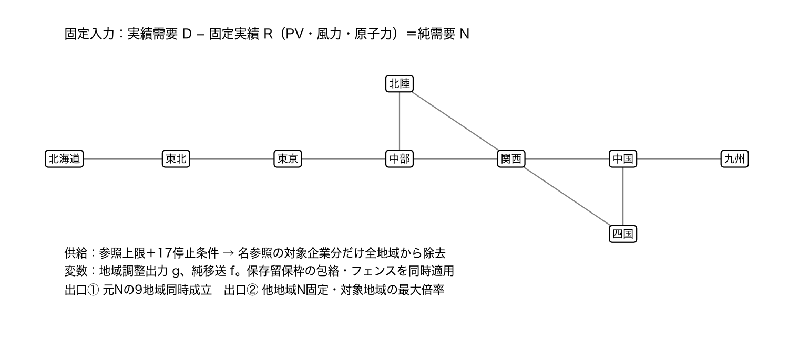
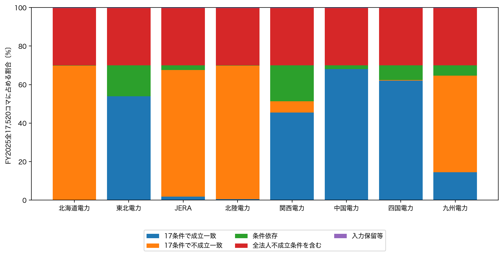
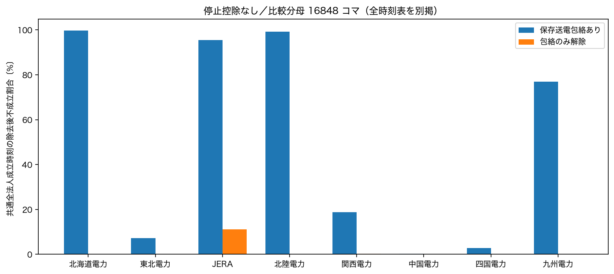
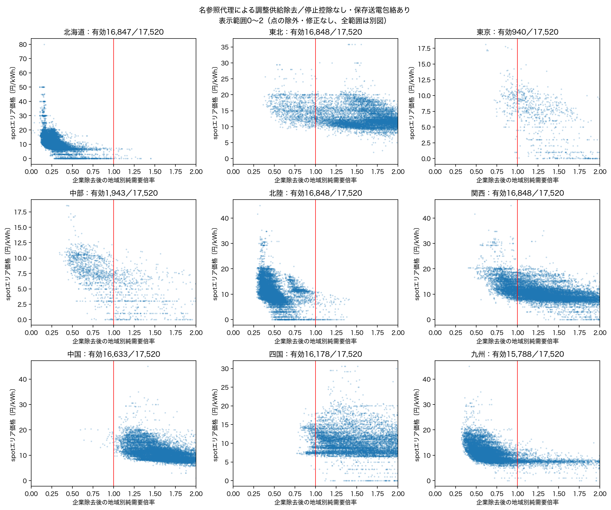
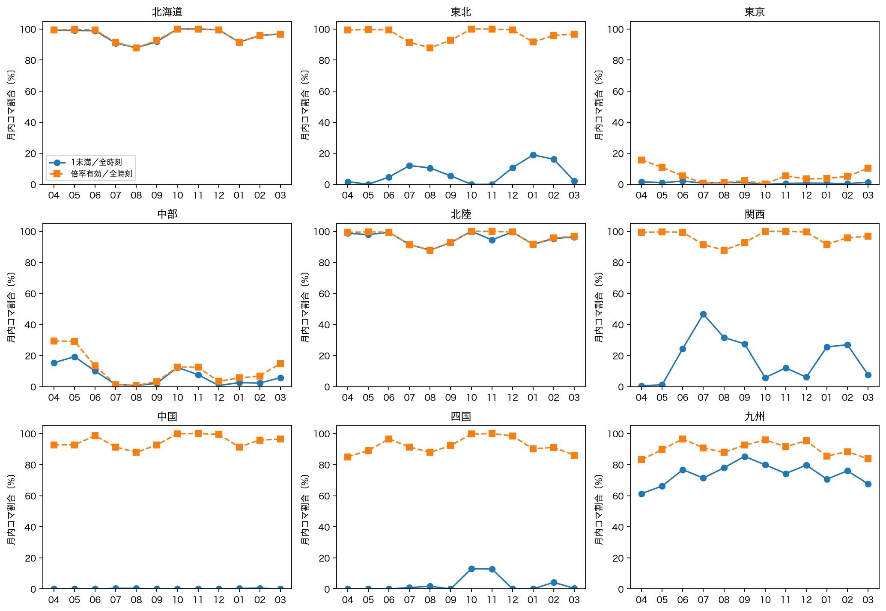

# FY2025・固定供給を残す調整供給除去の年間診断（Issue #46）

## 年間で何が分かったか

**4月を方法検証として残し、FY2025全17,520コマを、数値または理由付き状態で整備しました。** 未保有88地域月を公式一次資料から取得し、保有4月原本と中部年度ZIPを再利用しました。需要・PV・風力・原子力は9地域すべてで年間の30分値が揃っています。室蘭100MW・釧路112MWを含む同一設備集合で、同時成立・地域倍率・価格図を統一しました。

**送電条件まで定義できたのは17,472コマです。** 切替前16,608に加え、新フェンスの揃う3/14〜3/31の864を実装しました。3/13の48は保留であり、全17,520コマで送電ありの有効値があるとはしません。旧中央3区間と新フェンスを別能力として重ねていません。

中心の問いは、固定PV・風力・原子力の実績を残し、対象法人の名参照調整供給を他者・域外供給で代替できるかです。**今回の17条件すべてで全法人時に成立し、除去後に不成立となる時刻は、北海道12,228、北陸12,138、JERA11,498、九州8,780**でした。一方、全法人時から不成立となる条件を含む5,207時刻は、この比較へ足していません。結果は限定設備・参照上限・保存留保枠・名参照代理に条件付けられ、実際の供給不足や企業不可欠性の認定ではありません。

送電包絡を外すと結果は大きく変わります。停止控除なしで両方の全法人時が成立する共通16,848コマでは、JERA除去後の同時不成立は包絡あり16,081／なし1,861、北海道16,811／0、九州12,954／1でした。接続を切らず包絡だけを外したモデル上の対照であり、物理的増強効果ではありません。

価格は全結果へ欠落なく接続しました。倍率1未満の時刻で価格中央値が高いという並びは9地域で見られましたが、群の大きさ・需要・時間帯・季節は異なります。特に北海道の1超群は36コマだけで、JERA東京の倍率算定は940/17,520に限られます。**年間の価格との関連を、因果効果や実際の行使へ読み替えません。**

## 1．整備・計算・保留の範囲

| 工程 | 完了した範囲 | 保留・解釈 |
|---|---:|---|
| D/R一次値 | 9地域×17,520＝157,680地域時刻 | 必須D/R欠測0。元空欄、全空行のpaddingは原行表へ保持 |
| 供給上限 | 17条件、各8,468,544元観測行 | 元unit日のない行を生成しない。374候補の定義済み部分と集合外/保留を別記 |
| 保存送電入力 | 17,472/17,520コマ | 2026/3/13の48は理由付き保留 |
| 9地域同時成立 | 全法人595,680枠、8法人除去4,765,440枠 | 17条件×2送電条件の反復枠。成立・不成立・保留を保存 |
| 地域別倍率 | 5,361,120枠 | 17×2×9地域法人対×17,520。非正・全法人不成立等を0にしない |
| spot価格接続 | 5,361,120/5,361,120、100% | 独立した価格観測は157,680地域時刻。シナリオ反復を標本増としない |

実ソルバー呼出しは **3,893,807回**、完全同値入力のキャッシュ再使用2,541,156回です。包絡なしの解析解と、上限縮小による不成立の継承も使いました。対象枠数と実呼出し数は異なります。全出力に月・供給条件・送電条件・地域/法人・時刻のキーを保持しました。

停止控除なしの全法人時は、送電ありで成立16,848／不成立624／保留48、包絡なしで成立17,515／不成立5です。送電ありの624のうち5は限定集合の全国既知上限が純需要合計に不足し、619は全国合計だけでは説明できない送達・局所吸収条件です。これを地域全体の供給不足とはしません。[全条件・月別の理由表](qa/all_firms_monthly.csv)。

## 2．図1・表1：同じ入力版で何を計算したか

DとRは同じ公式燃料別資料・同じ30分区間です。固定Rを対象企業の除去時も残し、実績発電を供給上限から再控除しません。調整候補374のうち各時刻で上限を定義できる部分を使い、保留や未知を「能力0」と認定しません。名参照代理は所有・支配・契約配分ではありません。JERAは1法人として全地域から同時除去し、東京・中部を別評価します。制度10法人・11法人エリア対、EP/ミライズ未評価は維持しています。

| 変数 | 定義 | 単位・粒度 | 対象範囲 | 出典 |
| --- | --- | --- | --- | --- |
| D | 同じ燃料別CSVの公表実績需要 | MW平均・地域×30分 | 9地域17,520時刻。入力欠測0 | 公式一次CSV108地域月（新規88CSV＋保有8CSV＋保有年度ZIP12CSV） |
| R | 分析上固定するPV・風力・原子力実績の和 | MW平均・地域×30分 | Dと同じCSV・同じ区間。制御量を加算しない | 同上。原列と資料別契約を保持 |
| N | D−R | MW・地域×30分 | 非正も保存。通常倍率だけ保留 | annual_primary_input_ledger.parquet |
| U | 調整候補の参照上限・既存17停止条件 | 元kW／1000→MW | 374ラベル候補・数値定義部分の和。未知全容量の分母なし | 既存677台帳・Issue40年間unit表・工程25の2設備根拠 |
| 企業代理 | HJKS発電事業者名の除去代理 | 8法人・9地域法人対 | 所有・支配・契約と別。EP/ミライズ未評価 | 工程21全491設備代理表。地理による追加なし |
| 送電B | 原符号C−M−Wとフェンス係数 | MW・区間/フェンス×30分 | 17,472定義／48保留。保存留保枠を維持 | 保存翌々日CSV・公式切替資料（仕様書のページ参照） |
| 価格 | spotのエリア価格・実績system price | 円/kWh・地域×30分 | 157,680地域時刻。全結果枠join100% | 既存JEPX spot。感応度基準は別列 |
| REI | 一次実績との検算 | MW・地域×30分 | 原本の明示ヘッダーで地域を選択 | 補助資料。一次値を置換しない |

[表1 CSV](qa/table1_data_definitions.csv)／[数式・切替・実行契約](../../docs/annual_diagnostic.md)／[全出力列の型・定義](qa/output_column_dictionary.csv)。元値・出典行を残したまま派生列を加えています。

充放電は公表された純値のままです。九州の連系線は元CSVが送電正のため会計検算列だけ−1倍し、原列を保持しました。自家消費を再控除せず、制御量を実績Rへ足していません。四国等の蓄電池空欄を0にせず、総充電を推定復元していません。地域別の既存境界説明を[工程20の会計表](../20_april_all_supplier_balance/qa/accounting_boundaries.csv)から継承し、未確認の境界を年間確認済みとはしません。[年間の符号・空欄・非正N・公表合計検算](qa/annual_accounting_boundary_counts.csv)。

## 3．図2：17条件内で残る特徴と比較できない時刻

分母は各法人の**全17,520コマ**。成立一致・不成立一致・条件依存は、17条件とも全法人時に成立した12,265時刻の区分です。それ以外5,207時刻は全法人不成立条件を含み、48時刻は送電入力保留です。比較できない範囲を除去後不成立へ加えません。

| 除去する名参照法人 | 17条件とも除去後不成立 | 17条件とも除去後成立 | 条件依存 | 全法人不成立条件あり | 入力保留 |
| --- | --- | --- | --- | --- | --- |
| 北海道電力 | 12,228 | 19 | 18 | 5,207 | 48 |
| 東北電力 | 7 | 9,442 | 2,816 | 5,207 | 48 |
| JERA | 11,498 | 332 | 435 | 5,207 | 48 |
| 北陸電力 | 12,138 | 83 | 44 | 5,207 | 48 |
| 関西電力 | 1,033 | 7,972 | 3,260 | 5,207 | 48 |
| 中国電力 | 0 | 11,932 | 333 | 5,207 | 48 |
| 四国電力 | 45 | 10,882 | 1,338 | 5,207 | 48 |
| 九州電力 | 8,780 | 2,548 | 937 | 5,207 | 48 |

この一致は今回の17条件内のものです。全国未収録供給や契約、留保枠再設計まで含む頑健性を確認した意味ではありません。[年間全区分](qa/condition_consistency_annual.csv)／[月別全区分](qa/condition_consistency_monthly.csv)。

## 4．図3：保存送電包絡を残すと何が変わるか

停止控除なしを最初の説明用条件とし、最終baselineには選んでいません。比較分母は両方の全法人時が成立する**共通16,848コマ**、全時刻から除いた672（全法人不成立624＋入力保留48）を明記します。企業除去後の結果で比較時刻を選んでいません。

| 法人 | 共通比較時刻 | 包絡あり：除去後不成立 | 包絡なし：除去後不成立 |
| --- | --- | --- | --- |
| 北海道電力 | 16,848 | 16,811 | 0 |
| 東北電力 | 16,848 | 1,202 | 0 |
| JERA | 16,848 | 16,081 | 1,861 |
| 北陸電力 | 16,848 | 16,721 | 0 |
| 関西電力 | 16,848 | 3,150 | 33 |
| 中国電力 | 16,848 | 24 | 0 |
| 四国電力 | 16,848 | 482 | 0 |
| 九州電力 | 16,848 | 12,954 | 1 |

包絡なしでも全国接続・D/R・同じ上限・企業除去を維持します。全国残余を自由に融通できる対照であり、地域輸入能力を単純合算した実績や増強便益ではありません。各制約を原因として一意に認定していません。[比較分母・件数](qa/transmission_common_times.csv)。

## 5．図4：地域倍率と実際の価格

**表示だけ0〜2倍へ拡大**しています。範囲外も元データへ残し、[全範囲図](figures/04_multiplier_price_full.png)と[表示範囲・未算定件数](qa/scatter_display_windows.csv)を併記します。最大倍率は中国約1,123.68、九州1,817、四国1,832で、小さな正の純需要を分母とする値を削除・修正していません。

以下は各地域の全17,520コマ。中央値は有効時刻だけの値であり、地域ごとに母集団が異なります。

| 評価地域 | 倍率算定可能 | 1未満 | 倍率中央値 | 他地域固定の倍率問題が不成立 | 純需要非正 | 全法人不成立 | その他保留 |
| --- | --- | --- | --- | --- | --- | --- | --- |
| 北海道 | 16,847 | 16,810 | 0.253 | 1 | 0 | 624 | 48 |
| 東北 | 16,848 | 1,202 | 1.899 | 0 | 0 | 624 | 48 |
| 東京 | 940 | 173 | 1.255 | 15,908 | 0 | 624 | 48 |
| 中部 | 1,943 | 1,176 | 0.885 | 14,905 | 0 | 624 | 48 |
| 北陸 | 16,848 | 16,721 | 0.456 | 0 | 0 | 624 | 48 |
| 関西 | 16,848 | 3,150 | 1.328 | 0 | 0 | 624 | 48 |
| 中国 | 16,633 | 24 | 1.682 | 0 | 228 | 611 | 48 |
| 四国 | 16,178 | 482 | 1.941 | 0 | 685 | 609 | 48 |
| 九州 | 15,788 | 12,954 | 0.654 | 0 | 1,080 | 608 | 44 |

北海道にも1未満でない時刻があり、4月の全有効時刻1未満を年間の常態へそのまま延長していません。JERA東京の15,908、中部の14,905は、他地域Nを固定した倍率問題がどの非負倍率でも成立しない時刻です。値0ではありません。JERAの9地域元需要同時成立は1法人の検査で、倍率の有効時刻だけから企業全体の結果を要約しません。

価格の例：九州は1未満12,954コマの価格中央値10.32円、1超2,833コマ7.40円、東北は1未満1,202コマ15.16円、1超15,646コマ10.99円です。しかし中国の1未満は24コマだけ、北海道の1超は36コマだけです。倍率が低ければ必ず高価格になるとは言えず、図には同じ倍率近傍で価格が広く散らばります。[状態別の件数・中央値・四分位・範囲](qa/price_by_status_and_one_boundary.csv)。実績system priceはspot、感応度基準は別列のまま、既知2,271時刻不一致を保存しました。

## 6．年間平均に隠さない月別の違い

九州の有効倍率中央値は4月0.812から2月0.542へ変わります。北海道は4月0.288、1月0.154。中部JERAは4月423コマで算定できる一方、7月20、8月11コマだけで、その後の12〜3月の中央値が1超となる月もあります。この変化は同じ時刻集合の季節効果と断定せず、算定範囲の変化と併せて読みます。[9地域×12月の件数・倍率](qa/explanatory_monthly.csv)／[全17条件・月別status](qa/multiplier_status_monthly.csv)。

## 7．表2：仮定によって何が変わったか

| 仮定 | 診断仕様 | 今回の数値的影響 | 残る限界 |
| --- | --- | --- | --- |
| 限定設備・容量一定 | 374調整候補＋固定R、既知部分だけ | 17条件の保留数と既知上限を併記 | 不成立は実系統の不足・企業不可欠性ではない |
| 北海道2設備 | 室蘭100MW、釧路112MWを含む同一版 | 旧4月と新年間4月の全status一致。旧集合の年間再計算なし | 卸供給・発電端・送電端/契約は統一済みでない。釧路100MWへ無断置換しない |
| 停止不明の扱い | 元8条件と追加控除なし8比較 | 例：58,852早端・全停止0で関西の共通有効12,929中1,420が1未満→1超へ | 参照値へ戻すことは利用可能性の確認ではない |
| 停止0／平均低下量 | 既存2方式を保持 | 全法人時の既知部分和が同じ条件も0/null・保留量が異なる | 公表平均を時点損失と確認したわけではない |
| 保存送電B | C−M−Wを総純移送の包絡に使用 | 共通16,848時刻：JERA不成立16,081→包絡解除1,861 | 保留枠再設計・実混雑/増強効果の推計ではない |
| 年度末表示切替 | 新3フェンスが揃う864時刻を別契約で使用 | 3/13の48は保留。旧中央3区間は重ねない | 実物理切替の完了時刻は推定しない |
| 公表需要のみ | 観測充電の再現を要求しない | 全国既知上限不足5時刻、送達/局所吸収等619時刻（控除なし） | 総充電を復元しない。吸収先不足が残り得る |
| 価格比較 | 説明用条件を固定、全status・月別を併記 | 北海道1超36時刻の価格中央値1.005円、1未満16,810時刻10.93円 | 需要・季節・時間帯をそろえた因果効果や行使の証拠ではない |

停止保留を戻す8組は同じ時刻で比較しました。例えば58,852版・早端・全停止0では、関西の双方有効12,929コマ中1,420が1未満→1超となり、北海道の双方有効12,953ではその変更は0でした。関西では追加で1,711、北海道では1,680コマが倍率有効へ変わります。この選別を無視して中央値だけを比較しません。[全8組の月別対比較](qa/record_restoration_pairs_monthly.csv)。全法人の成立数も条件によって12,265〜16,848に変わります。全停止0と平均低下量で数値部分和が一致しても、0/null・保留範囲が同じとはしません。

**研究側に残る採否は、(1)停止保留を集合外とする本条件と参照上限へ戻す比較を論文でどう併記するか、(2)保存留保枠B・名参照・容量基準をどこまでの条件付き結論として用いるか、の2点です。** 年間取得・通常ETL・図の体裁や旧4月版との統一は今回完了し、判断待ちへ戻しません。中心仕様と最終結論は年間結果を確認後に決めるものとして未採用を保持します。

## 8．成果物の場所・再現・検証

データは共有repoの`data/`にあり、GitHubへ含めません。

| 保存先（`data/`以下） | 内容 |
|---|---|
| `interim/research_reference/20261027_annual_actuals_v1/` | 新規88公式CSV。元バイトと取得URL/日時/SHAを記録 |
| `interim/occto/annual_diagnostic/20261027_inputs_v2/` | D/R157,680行＋108地域月の全原行表 |
| `interim/occto/annual_diagnostic/20261027_supply_v2/` | 17年間unit表・地域上限・再開点。元行/型を保持 |
| `interim/occto/annual_diagnostic/20261027_network_v1/` | 期間別係数/上限・17,520状態・不使用旧表示元行参照 |
| `interim/occto/annual_diagnostic/20261027_results_v1/` | 月別の全法人/除去後同時成立、地域倍率、数値標本、再開点 |
| `processed/annual_diagnostic/20261027_publication_v1/` | 月別価格付き全結果・17条件一致の全時刻表・説明用条件 |

最初は[実行済みノートブック09](../../notebooks/09_fy2025_annual.ipynb)を開き、図→月別表→全データパスへ進めます。[固定manifest](../../metadata/annual_diagnostic_manifest_20261027.json)から各入力/出力のSHAを追跡できます。途中のinputs_v1/supply_v1は読取/精度検査時の未採用出力で、今回の図表には使いません。

[独立検証](qa/annual_independent_validation.json)：別のlambda定式化で年間216標本の最大値一致（最大差8.9e−16）、同時成立384標本（うち不成立181）を別LPで一致。保存解の残差は最大3.2e−12MW。旧4月の北海道倍率48,960枠と8法人同時成立391,680枠はjoin100%、全status一致。年間の全有効倍率と独立した元需要同時成立の対応例外0ですが、一般に最大倍率1以上だけから元需要成立を推論できないことは変わりません。

原本・旧固定版は683ファイルのSHA照合を実施しました。[不変性監査](qa/immutable_sha_audit.json)。全結果のキー/件数/型・出典・価格join・単位・境界・保留・新旧フェンス・キャッシュ等を検査。pytest **363 passed**、ruff通過、辞書更新後の関連23件も通過。最終版検査は[検証記録](qa/verification.json)へ。ユーザーの既存01/02ノートブック編集は保持しています。

再実行順序は`acquire_annual_actuals.py`→`build_annual_actuals.py`→`build_annual_supply.py`→`build_annual_network.py`→`run_annual_diagnostic.py`→`publish_annual_diagnostic.py`→`summarize_annual_sensitivity.py`→`validate_annual_diagnostic.py`。既存出力先への無断上書きはせず、月別再開点または新しい出力版を用います。

Issue #46／`issue/feature-46`、[Draft PR #47](https://github.com/gochiglog/jepx-market-power-analysis/pull/47)。依存元Issue #44／`issue/feature-44`。原本・旧版不変、raw/interim/processedのGit追跡0。問い合わせ・回帰・全供給除去・曖昧帰属の正式採用・最終baseline・企業不可欠性や売り渋り認定・PRマージは行っていません。
