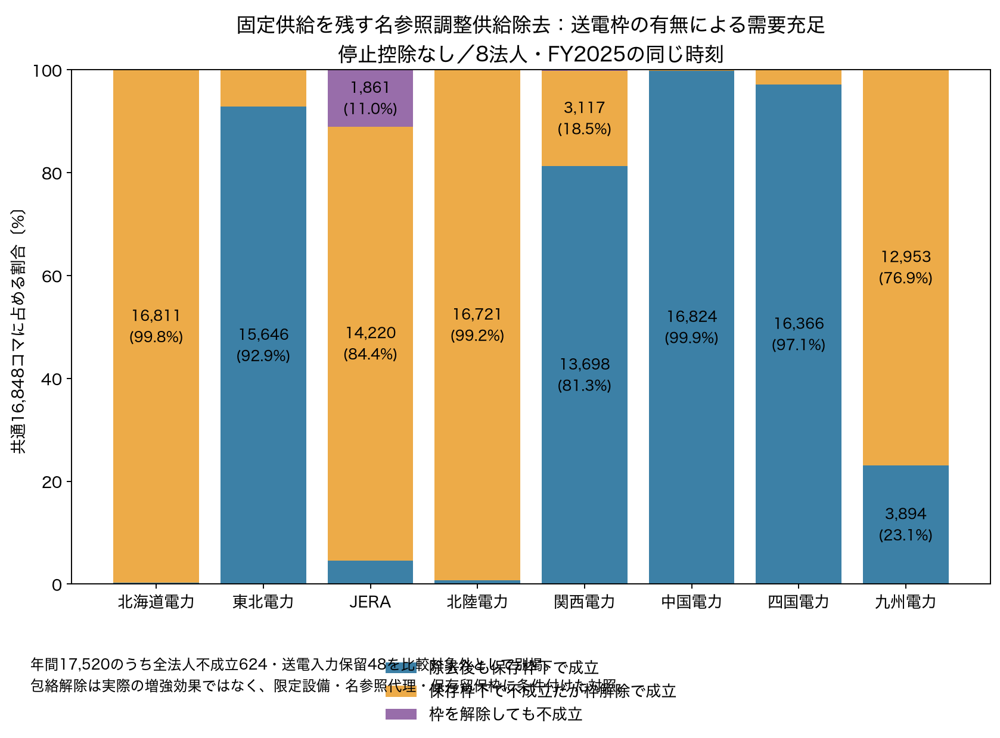
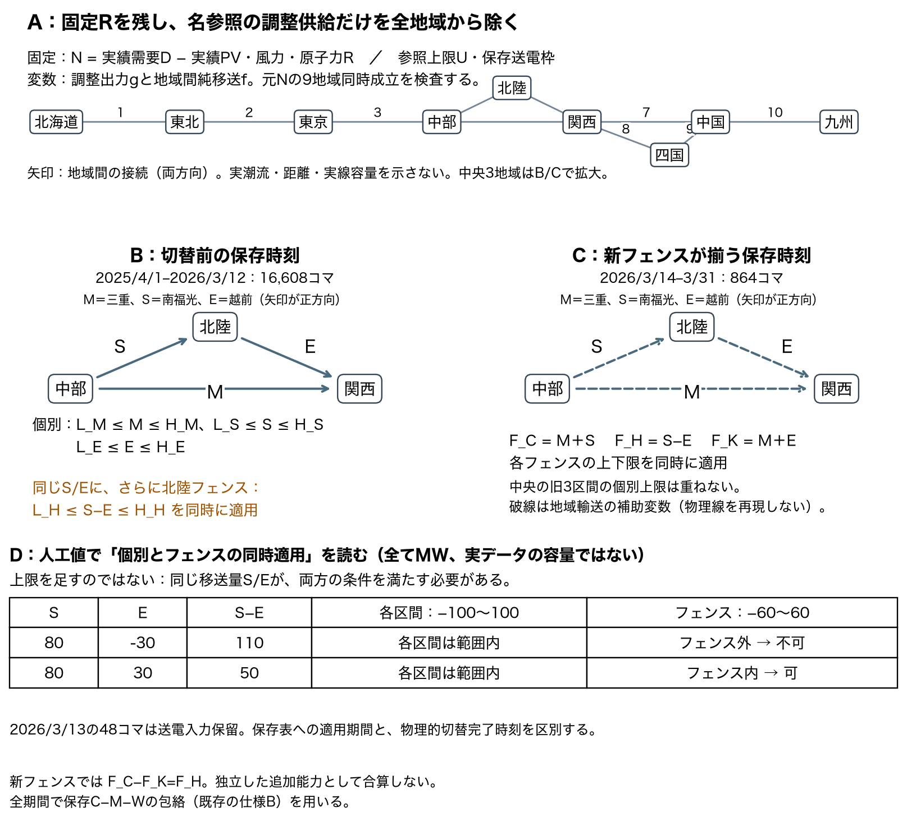
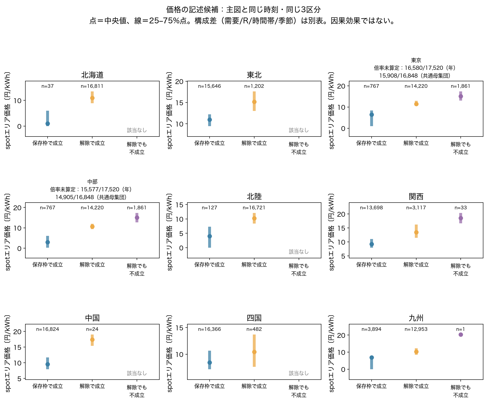

# 年間診断を論文の中心結果へ整理する（Issue #48）

## 論文で述べる一つの結果

**固定PV・風力・原子力を残した今回の限定診断では、主要法人の調整供給を代替できるかどうかは、保存された地域間送電枠を残すかどうかで大きく変わり、その程度は法人によって異なります。** この結果を、同じ需要・固定供給・設備上限・同じ時刻の3区分で示します。企業の実際の不可欠性、送電増強の効果、利益増加や売り渋りの認定はしません。

まず **[問い→結果→図→限定の1枚PDF](one_page_result.pdf)** をご覧ください。[同じ内容のMarkdown](one_page_result.md)もあります。推奨する本文は、**読み直した方法図＋排他的3区分の主図**です。17条件・月別・価格は付録へ回し、中心の主張を散らしません。これは掲載構成の提案で、最終baselineの採用ではありません。

## 1．主図：送電枠を残す場合と外す場合

| 除去する名参照法人 | 保存枠下でも成立 | 保存枠下で不成立だが解除で成立 | 解除しても不成立 | 行和 |
|---|---:|---:|---:|---:|
| 北海道電力 | 37（0.22%） | 16,811（99.78%） | 0（0.00%） | 16,848 |
| 東北電力 | 15,646（92.87%） | 1,202（7.13%） | 0（0.00%） | 16,848 |
| JERA | 767（4.55%） | 14,220（84.40%） | 1,861（11.05%） | 16,848 |
| 北陸電力 | 127（0.75%） | 16,721（99.25%） | 0（0.00%） | 16,848 |
| 関西電力 | 13,698（81.30%） | 3,117（18.50%） | 33（0.20%） | 16,848 |
| 中国電力 | 16,824（99.86%） | 24（0.14%） | 0（0.00%） | 16,848 |
| 四国電力 | 16,366（97.14%） | 482（2.86%） | 0（0.00%） | 16,848 |
| 九州電力 | 3,894（23.11%） | 12,953（76.88%） | 1（0.01%） | 16,848 |

**分母は8法人とも同一の16,848コマ**です。停止控除なし・保存枠あり／包絡のみ解除の**双方で企業除去前に全9地域の元純需要が成立した時刻**を使い、除去後の判定や価格によって時刻を選んでいません。年17,520の残りは全法人不成立624と送電入力保留48であり、除去後不成立へ加えません。JERAは東京・中部をまたいで一法人として除去し、この表では1回だけ数えます。

JERAは **767＋14,220＋1,861＝16,848** を再確認しました。全8法人で行和、共通時刻集合、元statusへの逆対応が一致しています。[数値表](qa/central_three_categories.csv)／[全時刻の比較対象外](qa/all_times_scope.csv)／[集計QA](qa/aggregation_audit.json)。主図は[PDF](figures/02_central_three_categories.pdf)・[SVG](figures/02_central_three_categories.svg)で利用できます。

橙の区分は「同じ限定供給で、保存枠を外したモデルでは割当てが存在する」という比較です。どの一本を増強すれば実現するか、費用・損失・安定度・実運用上可能かは示しません。紫も「この限定集合と参照上限では、包絡を外しても同時に満たせない」であり、未収録供給を含む実際の全国供給不足ではありません。

## 2．初見の読者が方法を追える図

[PDF](figures/01_method_readable.pdf)・[SVG](figures/01_method_readable.svg)。Mは三重、Sは南福光、Eは越前の正方向です。**同じS/Eへ、個別区間の上下限と北陸フェンスS−Eを同時に掛けます。フェンスを追加の供給能力として足しません。**

図の人工例では各区間±100MW、フェンス±60MWを仮置きしました。S=80、E=−30は個別範囲内でもS−E=110でフェンス外。一方S=80、E=30なら50で両条件内です。これらは説明用の人工値で、保存資料から確かめた線容量でも新しいLP条件でもありません。[人工例の表](qa/artificial_fence_examples.csv)。

切替前16,608コマは中央の個別3区間＋北陸フェンス、新フェンスが揃う3/14〜3/31の864コマでは中央3地域をM＋S／S−E／M＋Eのカット包絡で扱います。旧中央3区間の残存表示上限を重ねません。外側7区間は維持します。3/13の48は保留です。日付は保存表への適用範囲で、物理的切替完了時刻を確定していません。元の[工程27の実行契約](../../docs/annual_diagnostic.md)を変更していません。

## 3．先行研究との対応：同じ発想と異なる定式化

**[1ページ対照PDF](literature_contrast_one_page.pdf)**／[原式と4母線例を含む説明](literature_contrast.md)／[8項目の対照CSV](qa/technical_reference_contrast.csv)。保存済み著者原本の§4–6を再読し、式(14)（p16）、図6/表3（p19）、§6と図7（pp21–22）を確認しました。[確認記録](qa/technical_reference_review.json)。

原TCRSIは企業の利用可能供給を除き、**全母線負荷を同じ倍率**で拡大し、PTDFによるDC潮流制約を同時に扱います。今回の主図は倍率を使わず元Nを固定し、固定Rを残す名参照調整供給だけの除去・9地域輸送・保存留保枠を使います。補助の地域倍率も対象地域だけを変えるため、原TCRSIの再現ではありません。

原文の4母線例ではg3のRSI=1でもTCRSI=0.58です。供給量の全国合計だけでは見落とす送電上の制約を示す点は参照できます。一方、TCMPIは入札・清算結果と利潤最大化仮定を用いる別の指標です。今回の価格図は、原図7のTCRSI対TCMPIの比較でも、マークアップ・利益の評価でもありません。原文のTCRSIの事前的な位置づけと、今回の実績D/Rを使う事後評価も区別しました。新規性・国内初は主張しません。[著者公開原文](https://users.ece.utexas.edu/~baldick/papers/firm_index_technical.pdf)。

## 4．本文・付録・再現資料を分ける

| 配置案 | 置くもの | 理由 |
|---|---|---|
| 本文 | 今回の方法図、3区分主図と数値表、入力/主要仮定の短い表 | 中心の問いへ直接答える |
| 付録A | 工程27の17条件一致図、停止保留の対比較 | 主図の停止控除なしが結論をどこまで代表するかを示す |
| 付録B | 同じ3区分と価格の候補、倍率散布図と未算定表 | 価格は補助。対象地域別倍率の算定範囲を隠さない |
| 付録C | 月別図と今回の3区分月別表 | 特定月だけを選ばず、年間平均の偏りを確認する |
| 再現資料 | 旧送電比較2棒、倍率全範囲、全17条件/全status/原入力/行列・QA | 重複図を本文へ重ねず、元版を追跡する |

[ファイル・版・分母まで含めた配置表](qa/main_appendix_reproduction.csv)／[図注案](figure_captions.md)。17条件図は全17条件の全法人成立12,265時刻と比較対象外を分けます。主図の16,848へ混ぜません。本文には「17条件内で除去後不成立が一致する北海道12,228、JERA11,498」等の短い補足のみを候補にします。

## 5．価格は同じ3区分で見る補助候補

[PDF](figures/A01_price_same_categories_candidate.pdf)／[SVG](figures/A01_price_same_categories_candidate.svg)。主図と同じ時刻で、点＝価格中央値、線＝四分位範囲です。空区分は「該当なし」。JERAの同じ区分を東京・中部の価格へ参照し、別企業として重複集計しません。価格を選ぶために地域・時刻・閾値を変えていません。

ただし、**3区分は需要・固定R・時間帯・季節を揃えた群ではありません。** 例えばJERA東京の各区分は以下のように違います。D/R/Nの中央値はそれぞれ計算しており、中央値同士の差をNの中央値としていません。

| JERAの区分（東京の観測値） | コマ | 価格中央値 円/kWh | D中央値 MW | R中央値 MW | N中央値 MW | 06〜18時の割合 | 春3〜5月の割合 |
|---|---:|---:|---:|---:|---:|---:|---:|
| 保存枠下でも成立 | 767 | 6.45 | 27,196 | 12,220 | 15,366 | 100.00% | 62.97% |
| 解除で成立 | 14,220 | 11.38 | 29,907.5 | 349 | 27,464.5 | 47.38% | 26.62% |
| 解除しても不成立 | 1,861 | 15.04 | 40,057 | 241 | 39,137 | 45.78% | 4.57% |

価格の違いを送電や除去の因果効果と解釈できません。北海道も「保存枠下で成立」は37コマだけ（価格中央値1.01円、R中央値2,198MW）で、解除で成立16,811コマ（10.93円、R572MW）と群の構成が大きく違います。九州の解除後不成立は1コマだけであり、その1点を一般化しません。

全9地域・全3区分の[価格/D/R/Nの中央値・四分位・範囲](qa/price_demand_fixed_output_by_category.csv)、[6時間刻み4時間帯・4季節・12月の件数と構成比](qa/composition_by_season_time_month.csv)を併記します。**価格候補は付録を推奨**し、本文に残す採否は保留とします。推定・回帰・有意差検定は行っていません。

既存の倍率散布図を読む場合、東京は有効940／未算定16,580、中部は有効1,943／未算定15,577（いずれも年17,520）です。共通母集団でも東京15,908、中部14,905が未算定。この件数を今回の価格候補の同じ画面へ表示し、[同じ分母の未算定表](qa/multiplier_missing_in_same_view.csv)・[全status表](qa/multiplier_all_status_with_scope.csv)を用意しました。点群だけを地域・企業全体の代表とはしません。

## 6．残る採否と、今回完了したこと

**編集上は、本文を方法図＋3区分に絞り、17条件・価格・月別を付録へ整理しました。通常の編集判断について承認待ちは残しません。**

研究側に残るのは、論文の最終baselineで停止保留をどう扱うかです。停止控除なしの共通16,848時刻に対し、全17条件で全法人時に成立する共通範囲は12,265時刻となります。各条件の全時刻を併記するか、一条件を中心仕様として選ぶかで、比較できる範囲と除去後判定の要約が変わります。この差を同じ分母の停止効果と読まないことが必要です。今回の主図はユーザー指定の説明用条件であり、その採用を先取りしていません。名参照の契約帰属や保存留保枠Bの実運用への解釈も未確定のままです。

価格は付録候補として完成済みです。本文へ残す場合も、JERA東京の有効940コマだけの倍率散布図ではなく、主図と同じ16,848時刻の区分を示し、上記の需要/R/時間/季節の構成差を隣接させる必要があります。今回の作業を進めるための追加判断ゲートにはしません。

主図・方法図・文献対照・一枚表・図注・配置表・価格候補まで完成しました。新しい年間データ取得0、大規模LP0、既存指標変更0。旧版を上書きせず、派生データは`data/processed/paper_central_result/20261027_v1/`、版/入力/出力SHAは[manifest](../../metadata/paper_central_result_manifest_20261027.json)へ保存しています。

再集計は`python scripts/prepare_paper_central_result.py`、描画は`python scripts/plot_paper_central_result.py`と`python scripts/render_paper_summary_sheets.py`。新派生出力先の存在時は拒否します。最初の閲覧は[ノートブック10](../../notebooks/10_paper_central_result.ipynb)。pytest **368 passed**、ruff通過。全8法人の行和・元status・価格元列/型、旧年間版の入力/出力1,115件と旧報告42ファイルの不変性を確認しました。[QA](qa/verification.json)を参照。原本・工程27固定版・ユーザー01/02ノートブック編集を保持し、問い合わせ・年間再取得・全供給除去・回帰・企業不可欠性/売り渋り認定・最終baseline・PR mergeは行いません。

Issue #48、branch `issue/feature-48`、依存元 #46／Draft PR #47。工程番号28はIssue番号と別です。
