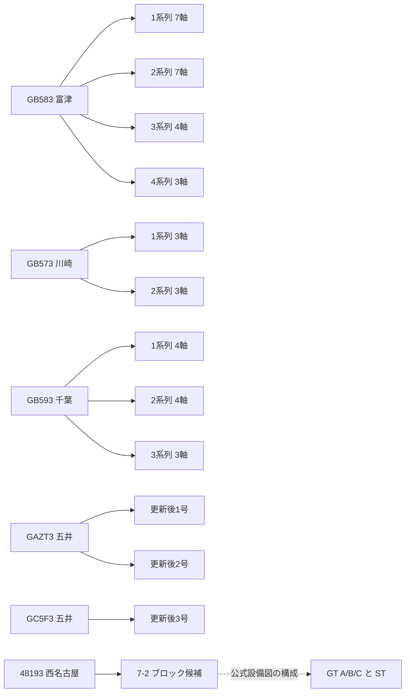

# Issue #15 上位10コードの公式設備資料確認（2026-10-16）

二層構造を可逆的なデータ設計として採用しました（RD-010）。分析baseline粒度は未確定です。
今回の目的は設備対応の裏付けです。発電実績が19.75%欠落していると判断したものではありません。
正式mapping、capacity時点適用、停止展開、換算、headroom、法人帰属は行っていません。

## 取得と確認方法

公開HJKSでコード10条件と発電所名9条件を検索し、検索後にCSVダウンロードする通常手順で19ファイルを保存しました。
直接CSVボタンへ条件だけ送ると全件CSVが返るため、その応答は保存せず、検索ボタン送信→CSV取得に修正しました。
全件の年間再取得は行っていません。検索結果のコード／名称条件を独立に検査しました。
終了設備を隠すcheckboxを送らず、hidden marker `_enddtFlg=on` を送っています。旧五井など終了設備も結果に含まれることを確認しました。
条件を満たすCSVはCP932で厳密復号でき、UTF-8 BOMはありません。元バイトは再エンコードしていません。

JERA公式発電所ページ9、公式パンフレット8、五井営業運転リリース1、TEPCOコード説明1、OCCTO注意事項1を追加保存しました。
合計39ファイルを共有repoの `data/raw/reference/issue15/` の新規取得時刻ディレクトリへ保存しました。
取得条件・日時・URL・HTTP metadata・元ファイル名・保存名・サイズ・SHAは
`metadata/research/asset_reference_manifest_20261016.json` に記録しています。セッション値・cookieは記録しません。
CSVの元名はHTTP Content-Dispositionから保持し、PDF等はURLのファイル名を保持しています。

確認レベルは**コードを跨ぐ設備対応候補**のレベルです。資料そのものを公式サイトから取得できたことだけでconfirmedにしません。
- confirmed：直接の設備対応根拠を確認。今回は0件。
- strongly_supported：複数の公式情報で所在地・名称・設備構成が整合。ただし直接crosswalkは未確認。
- candidate / ambiguous / unresolved：根拠不足・複数候補等。今回絞り込んだ49候補には0件。対象外候補の解決を意味しません。

## 上位10コード別の結果

全10コードの現在HJKSコード検索は0件でした。名称検索による現行設備候補は下表のとおりです。
HJKS側の事業者・認可出力・開始／終了日・最終更新日時は、元値のまま
[現在HJKS検索結果](top10_current_hjks_units_20261016.csv) に記録しました。1900/9999等の値を解釈で補いません。
設備表の出力は構成照合だけに使い、FY2025のcapacityとして適用していません。

| OCCTOコード | 設備構成とHJKS候補コード | 対応候補unit数 | 確認レベル | 公式事業者の根拠 |
|---|---|---:|---|---|
| GB583 | 富津1系列7軸・2系列7軸・3系列4軸・4系列3軸。HJKS34028〜34048 | 21 | strongly_supported | [富津PDF](https://www.jera.co.jp/static/files/corporate/business/thermal-power/list/futtsu/pdf/futtsu_2024_jp.pdf)物理p2 |
| GB573 | 川崎1系列3軸・2系列3軸。HJKS34049〜34054 | 6 | strongly_supported | [川崎PDF](https://www.jera.co.jp/static/files/corporate/business/thermal-power/list/kawasaki/pdf/kawasaki_2024_jp.pdf)物理p2 |
| GB593 | 千葉1系列4軸・2系列4軸・3系列3軸。HJKS34001〜34011 | 11 | strongly_supported | [千葉PDF](https://www.jera.co.jp/static/files/corporate/business/thermal-power/list/chiba/pdf/chiba.pdf)物理p2 |
| GB4Q3 | 姉崎新1〜3号。328Z0 / 328RV / 328RU。旧1〜4号とは分離 | 3 | strongly_supported | [姉崎PDF](https://www.jera.co.jp/static/files/corporate/business/thermal-power/list/anegasaki/pdf/anegasaki_202603_jp.pdf)物理p2 |
| GB553 | 常陸那珂1・2号。34091 / 34092 | 2 | strongly_supported | [常陸那珂PDF](https://www.jera.co.jp/static/files/corporate/business/thermal-power/list/hitachinaka/pdf/hitachinaka_2024_jp.pdf)物理p2 |
| GAZT3 | 五井更新後1・2号。330UQ / 331D8。旧GB663とは分離 | 2 | strongly_supported | [五井PDF](https://www.jera.co.jp/static/files/corporate/business/thermal-power/list/goi/pdf/goi_202609_jp.pdf)物理p2 |
| 48193 | 西名古屋7-2のCCブロック候補42393。4B193の7-2GTA/B/Cは構成機器として区別 | 1 | strongly_supported | [西名古屋PDF](https://www.jera.co.jp/static/files/corporate/business/thermal-power/list/nishinagoya/pdf/nishiNagoya_2024_jp.pdf)物理p2 |
| GC5F3 | 五井更新後3号331RJ | 1 | strongly_supported | [2025-03-03公式発表](https://www.jera.co.jp/news/information/20250303_2131)・五井PDF物理p2 |
| GV943 | 常陸那珂共同1号327YK。常陸那珂1・2号と分離 | 1 | strongly_supported | [JERA設備ページ](https://www.jera.co.jp/corporate/business/thermal-power/list/hitachinaka-kyodo/)基本情報 |
| GAWA3 | 横須賀更新後1号328XX。旧3〜8号と分離 | 1 | strongly_supported | [横須賀PDF](https://www.jera.co.jp/static/files/corporate/business/thermal-power/list/yokosuka/pdf/yokosuka_2024_jp.pdf)物理p2 |

上表は10コード群・49元unit候補・49HJKS行の候補対応です。confirmed0、strongly_supported49、candidate0、ambiguous0、unresolved0。
**コード差の理由は10群すべて未解決**です。候補レベルの集計とコード体系の解決件数は別です。
一覧：[設備対応根拠49行](top10_official_mapping_evidence_20261016.csv)。前回のfuzzyだけで確認レベルを引き上げたものではありません。

富津・千葉・川崎・常陸那珂・西名古屋の画像PDFは物理p2を画像で目視確認しました。他のPDFは設備表を確認しました。
五井PDFは2026年9月版、姉崎は2026年3月版です。資料名の年だけをFY2025各時点の登録版と扱いません。
五井3号の運開は2025-03-01と2025-03-03発表にあり、FY2025開始前の存在を裏付けます。事業承継・持分・契約供給力を今回の名称対応から確定しません。

## OCCTO側の設備構造

[全49元unitの設備表](top10_occto_equipment_structure_20261016.csv) は既存月別rawから、燃種・観測開始／終了・FY2025観測kWhを整理しました。
観測開始／終了はCSVに行がある期間であり、設備の商業運転開始／廃止日ではありません。空セルは0発電と解釈しません。
同じsourceコードの下に複数の元plant名・unit名があるため、元plantラベル数を物理サイト数と呼びません。

実線はOCCTO元ラベルの整理、点線は公式設備図の構成説明です。コード間の正式crosswalkではありません。
残る姉崎新3機・常陸那珂2機・共同1機・横須賀1機はCSVに全記載しています。

## coverageの再計算

分母は363元plantラベル・491元unit候補、数値観測合計646,505,684,424kWhです。物理設備数でも欠測補完後電力量でもありません。
plant対応率は元ラベル数、unit対応率は元unit候補数です。前回の時間行ベースmatch率とは分母が異なります。
plantでは元ラベルに含む全unitに一意の候補がある場合だけ追加し、unit側は一意の候補だけを追加して試算しました。

| ケース | plant対応 | unit対応 | plant観測量coverage | unit観測量coverage | plant未対応観測量kWh | 東京coverage | 中部coverage |
|---|---:|---:|---:|---:|---:|---:|---:|
| A 現在strict | 296/363（81.54%） | 353/491（71.89%） | 80.2468% | 61.5927% | 127,705,401,000 | 35.5847% | 90.7836% |
| B confirmedのみ追加 | 296/363（81.54%） | 353/491（71.89%） | 80.2468% | 61.5927% | 127,705,401,000 | 35.5847% | 90.7836% |
| C strongly_supported含む参考 | 345/363（95.04%） | 402/491（81.87%） | 97.5729% | 78.9188% | 15,691,247,000 | 91.9154% | 99.2774% |

**正式追加0件。Cは感度確認のみでbaselineにはしません。**
Cで説明候補が付く観測量112,014,154,000kWhは、元plant未対応量の87.71%に相当します。source観測量を一回だけ数えています。
残り12.29%の未対応量は今回の上位10コードの調査範囲外です。
前回の名称候補だけを全採用する条件付き100%とは異なる試算です。今回Cは保存した公式設備根拠のある10コード49候補に限定しました。
集計JSON：[QA](top10_official_review_qa_20261016.json)。既存strict候補CSV・QA・generation longは変更しません。

## 677行版の取得漏れの証拠

名称検索9結果の延べ88行（共同1行が重複するためdistinct87設備ラベル）について、area・code・plant・unitの元識別を677版と比較しました。
**677版にない設備は0件**でした。したがって今回の調査から台帳全件の再取得を勧める根拠は得られていません。
検索範囲は上位10コードの関連名称のみです。全国の完全性や、同一設備のcapacity・更新日時の不変性を証明したものではありません。
529/677版の採用・履歴解釈は引き続き別判断です。outageは再取得していません。

## コードの違いと二層設計への含意

[TEPCO説明](https://www.tepco.co.jp/forecast/html/unit-j.html)は発電所コードをHJKSのコードと説明しています。
一方、今回の現行検索ではsourceコードは見つからず、別コードで号機・軸ごとの設備が掲載されます。
この観測と説明だけでは、旧新コード、制度改番、親子設備、システム間差のいずれかを確定できません。
公式の個別対応表・改番履歴・適用期間は見つかりませんでした。「コード変更」と断定しません。
[OCCTO注意事項](https://www.occto.or.jp/contact/unit.html)の計測・試運転等の注意も、個別コード差の説明とは扱いません。

二層設計では、sourceコード／元名称、HJKSコード／元名称、設備階層候補、根拠資料、確認状態、有効期間の未確認を別々に保持する必要があります。
特に西名古屋はブロックとGT機器を同じ容量として合算できません。unit情報を残さずplantへ先に合計しても問題は解消しません。
同じ設備候補であることは、所有・運営・契約供給力や規制対象法人の帰属が同じことを保証しません。
RD-010に従い元unitを保持できる設計とし、集約後の数値だけを残す構造にはしません。集約処理自体は今回は実行しません。

## 判断ゲートと次の推奨

判断事項は49件のstrongly_supported候補を今後どの条件で正式対応に昇格できるかです。

| 選択肢 | 数値的影響・長所 | 短所・根拠の限界 |
|---|---|---|
| A strict維持、公式対応表／回答を先に確認（推奨） | 正式80.25%を維持。未確認対応を研究入力に混ぜない | 確認待ちが残る。問い合わせは別途送信承認が必要 |
| 49件を候補として別表保持し、Cのみ感度確認に使用 | 参考97.57%までの改善可能性を記録できる | 正式コード・期間根拠は未確認。baselineへ自動採用しない |
| ユーザーが設備ごとの根拠を審査して正式採用を別途承認 | 採用範囲に応じcoverageが変わる | capacity時点・停止・法人帰属は別判断。coverageだけで承認しない |

公式根拠は上表の設備資料とHJKS検索です。これらは異コードの同一性を直接示していません。
先行研究から日本の個別コード対応を決定することもできません。従来のunit情報保持の方法論は参考に留めます。
推奨はstrictを維持し、[問い合わせ案](asset_code_inquiry_draft_20261016.md)を確認したうえで公開対応表の有無を照会することです。まだ送信していません。
**ここでユーザー判断を待ちます。headroom等には進みません。**

## 変更と検証

実装：`src/official_asset_review.py`、診断CLI、公開参考資料取得CLI。metadata：追加取得manifest・設備根拠・変数辞書・RD-010。
報告：現行HJKS検索結果、OCCTO設備構造、候補根拠、coverage QA、問い合わせ案。
pytest **176 passed**（既存172＋追加4）、ruff通過。confirmedとstrongly_supportedの分離、曖昧候補の非採用、候補重複の非加算、plant部分対応の非過大計上、実rawによる再計算と保存QAの一致を検査しました。
既存登録raw203件のサイズ・SHA256監査通過。新規reference39件もSHA一致。元strict候補CSV・QAおよびgeneration longのSHAも一致しました。
参考：[今回のSHA監査](top10_reference_raw_hash_audit_20261016.json)。従来の取得manifestから見た追加39件は別reference manifestで管理し、登録外OS管理ファイル3件と区別しています。
raw/interim/processedのGit追跡は0件を維持し、Issue #15専用ブランチへ資料・コード・軽量QAだけを記録します。Draft PR #16はmergeしません。
